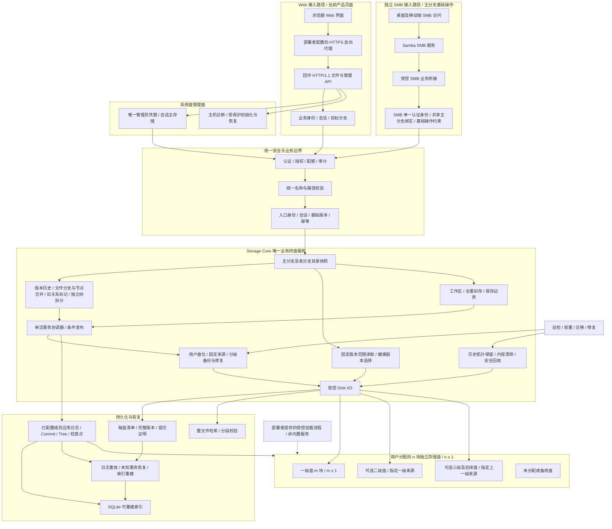

# 03 总体架构与模块边界

[文档目录](README.md) · [上一章：术语、对象与核心不变量](02-concepts-and-invariants.md) · [下一章：Web 与 SMB 访问入口](04-platforms-and-access.md)

一张完整总架构图，以及 Web、SMB、核心和持盘边界。

## 本章目录

- [3.1 完整总体架构图](#s03-01)
- [3.2 接入与持盘边界](#s03-02)
- [3.3 技术基线](#s03-03)

## 3.1 完整总体架构图

Web 经部署者配置的 HTTPS 反向代理转入守护进程的回环 HTTP API，SMB 经 Samba 和服务端桥接接入；两条用户路径分别建立连接，在服务端共用认证边界、存储核心、持久化和分层备份。SMB 的主分支与基础操作限制由服务端执行，Web 私有工作区的分支选择不改变 SMB 目标。

## 3.2 接入与持盘边界

采用 Samba 承担 SMB 协议服务，通过受控业务桥接将基础文件操作送入 Storage Core。桥接采用 Samba VFS 扩展和受保护本机接口；目标 SDK 与已验证路径见[SMB 桥接说明](components/smb.md)。其他版本及完整应用操作矩阵仍需单独验证。这里需要实现业务对接，但不重写 SMB 协议、不开发客户端虚拟盘，客户端无需本系统自研挂载。[S03][S04]

SMB 共享绑定 `(repository_id, history_tree_id, main_branch_id, share_generation)`，只展示该主分支当前文件。已实现的分支、历史图、清除、拆分、备份和磁盘管理通过获授权 Web/API 访问；不得借可写隐藏目录或特殊文件名触发。

SMB 服务及 API 网关不直接共享版本对象目录。Storage Daemon 仍是业务持盘和授权的最终边界；桥接只能提交受限请求，不能绕过命名、保护份数或历史保存。Samba 本身不能替本系统提供版本事务或跨盘保护保证。

Web 在浏览器中提供认证、文件元数据、历史与管理状态界面，不提供文件上传、下载、正文预览或传输任务页。SMB 入口由 Samba 和服务端业务桥接独立提供；受控 HTTP 内容接口和客户端库仍保留，但不是产品 CLI。`zxs` 直接启动守护进程；`zxs-rescue` 只提供明确的离线恢复、历史包与未初始化配置草稿工具，不提供日常管理命令或远程客户端。

管理 HTTP、登录和主机诊断不等待数据引擎打开。`management-auth.json` 是唯一管理员凭据和会话的系统盘主存储；数据盘只接收不含会话的凭据灾备快照，不是离线授权回退。缺失已有主存储时保持恢复要求，不因数据盘可读而自动回滚凭据。详见[管理面边界](management/control-plane.md)。

系统盘不是“仅可丢弃索引”：除独立管理主存储外，池系统目录还保存配置、工作区记录与请求证据；`stage_bytes` 和范围写入会在该目录创建真实正文临时文件，HTTP 暂存也有独立预算与保留规则。不能按“都是缓存”清空系统目录，也不宣称已经将所有正文暂存搬到数据盘。

元数据成员由用户显式指定，N ≥ 1 个不同物理存储盘可兼任控制日志成员，不要求另外增加硬盘。最小部署只需系统盘和一块一级存储盘，不必设置任何备份级别；二、三、四及后续级别仍按需要配置。数据盘各自独立，不组成跨盘条带。单盘目标达标只表示已持久保存一份，不提供冗余或永久丢盘恢复保证；唯一数据盘不可用也不应阻止系统盘上的管理登录与诊断。

### 恢复与历史包的验证边界

启动读取的盘上字节和离线历史包均是外部输入。历史图对象在文件边界严格解码、限制大小并核对引用的 domain hash；私有字段的 `AuthenticatedMetadataObject` 同时持有 JSON 值及其 canonical bytes。图解析器检查 schema、radix 路由、实体唯一性与页格式，字节长度检查、精确副本修复和导出复用这份已认证字节。

完整快照的引用闭包及 history 语义通过后产生 `AdmittedState`，消费前仅提供只读访问。冷恢复将候选绑定的精确历史图与该快照投影作 canonical equality 比较，因此不再对同一逻辑 history 再执行一遍语义准入。没有已准入快照的 checkpoint 路径，以及离线包和独立历史图读取，仍执行完整 history 语义验证。日志扫描产出的帧哈希随已有 sequence/candidate 分组传递，回放只在当前候选的成员 receipts 中查找发布证据。

这些复用均限于当前读取/恢复过程，保留四阶段持久化、损坏副本选择、fork、torn-tail 和缺失证据处理。逐历史根的图展开及派生容器修复仍可能重复全量工作；这里没有消除全部历史规模二次方成本。 测量与边界回归见[恢复路径去重验证](validation/recovery-deduplication.md)。
### 操作标识的信任边界

`storage_contract::OperationId` 用私有 16 字节 UUID 表示操作身份，内部直接生成并按值传递。HTTP 字段提取、已认证 SMB 会话的请求分派、救援 CLI 参数解析，以及启动/恢复/导入时的反序列化，把外部字符串解析一次；核心的变更、查询、计划、提交与恢复接口依赖该类型，不再检查 `op_` 前缀。

外部及磁盘格式仍为 `op_` 加 32 个小写十六进制字符；全零和非 v4 值继续有效。普通业务 HTTP 变更的格式错误保持 `INVALID_ID`，缺失、空值或非字符串保持 `INVALID_REQUEST`；操作查询中的非空畸形 ID 保持 `OPERATION_NOT_FOUND`。SMB 帧层接收 `Request<String>`，会话内转换为 `Request<OperationId>`；畸形 ID 返回不含 operation_id 的 `INVALID_REQUEST`，保留会话和现有句柄，且不创建工作区或暂存数据。

SMB 的操作查询和工作区提交通过 `Backend::operation`、`Backend::commit_workspace` 直接传递领域记录；HTTP 单独负责 wire 编码。当前身份、操作所有者、工作区所有权、fence 及解锁 I/O 后重新鉴权仍按原流程执行。`principal`/actor 仍是另一项约束，本次操作标识类型化不替代它。

仅 `State.operations` 和 `operation_principals` 改用操作标识键。两者不属于历史 manifest，快照增量逻辑只消费其变更集是否为空；显式 `Tracked::insert` 标记 `All`，保持原来的整字段重新编码行为。快照分页边界仍对规范 `op_...` 字符串字节哈希，UUID 字节排序与旧小写定长字符串排序一致，原有 wire、请求摘要及内容寻址格式保持不变。

## 3.3 技术基线

| 领域 | 基线 | 说明 |
| --- | --- | --- |
| 服务端 | Rust Storage Daemon | 一个有效写协调器；可并行准备数据，按事务顺序发布 |
| 独立 SMB 接入 | Samba / SMB 3 系列 | 共享主分支基础文件，独立于 Web 接入，服务端统一执行业务规则；不启用 SMB1 |
| SMB 业务桥接 | Samba VFS 扩展到受控核心接口 | 同步执行核心业务操作；完整操作路径按目标 SDK 验证 |
| 本机内部通信 | Unix Domain Socket | 受信服务身份和受限用户代理，不接受任意身份自报 |
| Web / 受控 HTTP 客户端 | 对外 HTTPS，守护进程回环 HTTP/1.1 | TLS 终止由部署者配置；HTTP/2 或 HTTP/3 需由反向代理另行提供与验收，不是守护进程当前支持的协议 |
| 浏览器界面 | 仓库内维护的 Rust/WASM CSR 与响应式运行时 | 文件与高级管理功能均经统一业务 API 访问；浏览器兼容与实际交互单独验收 |
| 每盘文件系统 | 独立 Btrfs | 保持数据校验；恢复环境兼容性独立验收 |
| 内容格式 | 仅 FULL 普通文件 | 每个新写内容版本独立完整；分支创建引用冻结父版本，首次写入才生成自有 FULL |
| 元数据 | N ≥ 1 个固定配置成员的应用日志与检查点 | floor(N/2)+1 成员决定；全部 N 成员保护后正常发布，不按在线数缩小成员集合 |
| 索引 | SQLite，可重建 | 不将 SQLite WAL 当成跨盘事务 |
| 校验 | BLAKE3 整文件与分段清单 | 范围验证和全文件验证分别执行 |
| 命名 | PortableName / PortablePath | 固定 Unicode 数据版本，各入口统一校验 |
| 恢复 | 独立只读离线工具 | 不依赖在线索引或其他历史版本打开本盘文件 |

[S03]: https://www.samba.org/samba/docs/current/man-html/smbd.8.html
[S04]: https://www.samba.org/samba/docs/current/man-html/smb.conf.5.html

---

[文档目录](README.md) · [上一章：术语、对象与核心不变量](02-concepts-and-invariants.md) · [下一章：Web 与 SMB 访问入口](04-platforms-and-access.md)
