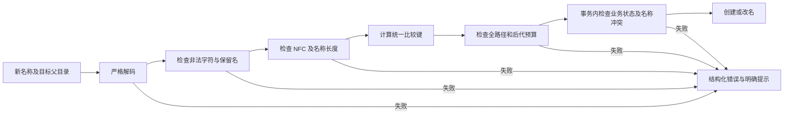

# 05 统一命名与路径规范

[文档目录](README.md) · [上一章：Web 与 SMB 访问入口](04-platforms-and-access.md) · [下一章：版本、分支引用、合并连线与树拆分](06-history-and-branches.md)

<a id="s05"></a>

字符、Unicode、大小写、长度、导入校验和错误提示。

## 本章目录

- [5.1 命名策略定位](#s05-01)
- [5.2 字符与编码](#s05-02)
- [5.3 Unicode 规范化与不静默改名](#s05-03)
- [5.4 大小写与规范等价冲突](#s05-04)
- [5.5 长度和深度：拟定的保守预算](#s05-05)
- [5.6 文件夹移动与批量导入](#s05-06)
- [5.7 权威校验流程](#s05-07)
- [5.8 错误展示契约](#s05-08)

<a id="s05-01"></a>

## 5.1 命名策略定位

采用仓库级固定策略：`PortableName` 和 `PortablePath`。

这是本系统主动选择的保守可移植范围，**不是声称六个操作系统的全部命名规则本来相同**。所有入口执行同一规则；不能允许 Linux/Web 创建其他平台必然无法表示的名称，再由其他客户端擅自改名。

命名规则及 Unicode 数据表版本写入仓库元数据。客户端可做预检，服务端必须在最终事务内再校验，包括并发重名检查。

<a id="s05-02"></a>

## 5.2 字符与编码

| 项目 | PortableName 规则 |
| --- | --- |
| 编码 | 协议使用严格合法 UTF-8；SMB 和 API 入口必须拒绝孤立 UTF-16 代理项；不得替换成 U+FFFD 后继续 |
| 常用文字 | 接受所固定 Unicode 表中的字母、组合标记和数字，支持中文等常见文字 |
| ASCII 标点 | 允许普通空格，以及 `! # $ % & ' ( ) + , - . ; = @ [ ] ^ _`、反引号、`{ } ~` |
| Windows 保留字符 | 拒绝 `< > : " / \`、竖线（`U+007C`）、`?`、`*`；分隔路径的 `/` 不属于文件名组件 |
| 控制与隐形格式 | 拒绝 NUL、控制字符、双向格式控制、零宽格式控制、具有 `Default_Ignorable_Code_Point` 属性的字符（包括变体选择符）、私用字符、非字符及未分配码点 |
| 常见中文标点 | 明确允许 `、。，；：？！“”‘’（）【】《》〈〉「」『』〔〕·—…`；逐码点固化，不按外观映射成 ASCII |
| 其他符号 | 当前策略采用上述允许集；不在允许集中的符号和 emoji 明确报错，未来如需扩展必须显式修改策略与测试 |
| 点名称 | 拒绝空名称、`.`、`..`；允许 `.gitignore`、`.DS_Store` 等普通点开头名称 |
| 首尾 | 拒绝开头或结尾的普通空格；拒绝末尾英文句点；内部普通空格允许 |
| 设备保留名 | 大小写无关地拒绝 `CON PRN AUX NUL COM1..COM9 LPT1..LPT9` 及扩展名形式；也拒绝相关上标数字形式 |
| 额外防御保留名 | 本系统额外保留 `CONIN$`、`CONOUT$`、`CLOCK$`、`COM0`、`LPT0`；这是策略收紧，不声称它们在所有系统均被原生禁止 |

Windows 的保留字符、设备名和末尾空格/句点限制来自官方文档；其余收紧项目是本系统的设计选择。[S13] `报告（终稿）.docx`、`项目、预算.xlsx` 在当前策略中是合法样例，但仍须通过 NFC、保留名及路径预算检查。ASCII 冒号 `:` 仍拒绝；全角冒号 `：` 是独立的允许字符，系统不作两者之间的自动替换。

容器位置还有一项根部保留约束：新事务实际使用的主盘或备份投影路径，其第一个分量不得与内部标记 `.zxs-namespace.json` 具有相同的规范查找键，包含大小写及 Unicode 折叠等价拼写。冲突在事务决定前返回 `NAME_COLLISION`，不能把它留到决定后、PUBLICATION 前的目录同步阶段。该名称作为更深层分量仍可使用，例如 `safe/.zxs-namespace.json`；普通名称校验本身不将它全局禁用。物理布局与已发布历史的读取规则不因此变化。

仓库固定记录命名策略及 Unicode 数据版本，不随客户端升级自动改变。策略迁移须预检全部保留目录树、比较键和平台样例，并持久化迁移事件。历史提交记录其创建时策略；不支持该策略的客户端须明确拒绝相应写入。

设备名判断使用**首个英文句点前的主名**，再对该主名去掉尾部 ASCII 空格/句点作防御性检查。因此 `NUL.txt`、`con.tar.gz`、`CON .txt` 不得绕过限制。这个检查只用于判定并拒绝，不用于修改用户的名称。

允许 `$` 和 `~` 等字符是为了兼容常见应用临时文件；后端必须把名称作为数据传递给文件 API，不能拼接到 shell 命令执行。

<a id="s05-03"></a>

## 5.3 Unicode 规范化与不静默改名

规范存储形式采用 NFC；NFC 属于 Unicode 规范等价规范化，不是把任意外观相近字符替换为同一个字符。[S14]

创建、改名、导入等**提出新名称**的操作必须提交规范 NFC 名称。Web 等交互式客户端在发起创建前发现非 NFC 名称时，展示原名称和规范候选名称，要求明确确认，再提交 NFC 名称；服务端收到非规范新名称一律返回 `NAME_NOT_NORMALIZED`，不能静默转写。确认属于客户端交互，不允许用请求中的“已确认”标志绕过服务端规范检查。

SMB 请求及后台上传不阻塞等待 GUI 确认。收到非规范新名称时返回对应入口错误、保留已有工作数据并记录活动项；用户在 Web 确认后，以新请求提交规范名称，再由原应用显式重试。不能把失败的原请求事后伪装成成功。SMB 服务不能通过名称改写绕过核心校验；具体客户端不能稳定往返合法名称时，其写入能力不得通过验收。

对于平台在文件系统边界将**已存在名称**以规范等价形式传回的情况，查询可以按规范等价键匹配已有条目。这不产生改名事件，也不允许非法字符通过。新名称仍须走创建规则。平台适配器必须对 macOS 等环境的名称往返行为做专门测试。

核心区分新名称校验 `validate_name` / `validate_path` 与已有名称引用校验 `validate_lookup_name` / `validate_lookup_path`。后者只免除输入必须已为 NFC 的要求；原始输入的字符允许表、忽略字符拒绝、设备保留名、路径结构、深度及 UTF-8 / UTF-16 长度预算全部不变，不先归一化再放宽预算。随后仍使用相同的 Unicode 16.0 完整大小写折叠与规范等价键，不改变持久化命名策略或条目唯一性。

SMB 属性查询、已有条目打开、改名源和删除源，以及 HTTP 路径解析与只读目录查询使用已有名称引用规则。`mkdir`、改名目标、导入和上传提交的新路径仍严格要求 NFC。SMB 同时允许打开或创建的请求先匹配已有条目：命中时保留该条目的显示路径，包括后续可写句柄保存；未命中而请求创建时，须在分配工作区或工作文件前通过新名称校验。查询输入不成为新条目的显示名，目录快照的作用域路径也从已匹配条目取得。

Unicode 分类、规范化及大小写折叠数据固定为可复现的版本，当前策略使用 Unicode 16.0.0 数据文件；实际实现应随源码固定这些表及其校验值，不能直接随宿主机系统升级而变化。[S20]

<a id="s05-04"></a>

## 5.4 大小写与规范等价冲突

仓库采用**保留显示大小写、大小写不敏感匹配**的统一策略，包括 Linux SMB 客户端。

```text
canonical_name = 已验证的 NFC 显示名称
lookup_key = NFC(Default_Unicode_CaseFold(canonical_name))
唯一性范围 = 同一分支目录状态中的 parent_entry_id + lookup_key
```

`Report.txt` 与 `report.txt` 不能在同一目录并存。显示名不会被自动变成小写。

Unicode 大小写折叠不是所有系统本地比较器的逐项复制。服务端 API、SMB 桥接和浏览器校验使用同一命名契约；本项目不提供桌面适配器。发行验收仍须用目标平台的实际 SMB 客户端检查“服务端认为不同、系统却认为同名”的边界，不能把统一服务端规则当作所有客户端已经验证。

只改变大小写的改名必须作为服务端原子元数据事务处理，而不是删除后再创建。路径查找的规范等价处理也不能用于自动覆盖已有文件。 已明确授权的覆盖写入通过等价路径找到已有文件时，保留其现有显示路径；提交新正文不隐式改名，名称变更仍走显式改名事务。

<a id="s05-05"></a>

## 5.5 长度和深度：拟定的保守预算

| 项目 | PortablePath 上限 | 性质 |
| --- | --- | --- |
| 单名称 UTF-8 编码长度 | 240 字节 | 本系统策略，不是统一 OS 上限 |
| 单名称 UTF-16 长度 | 240 个代码单元 | 本系统策略 |
| 仓库根相对路径 UTF-16 长度 | 200 个代码单元，含内部分隔符 | 为较短挂载根和旧应用留出空间 |
| 仓库根相对路径 UTF-8 长度 | 768 字节 | 双重预算，避免按“字符数”漏判 |
| 目录深度 | 32 层 | 控制遍历和平台路径风险 |
| 桌面挂载根 | 尽量短；客户端额外验证绝对路径预算 | 挂载根不应包含长用户名、分支全名或深层业务目录 |

单个名称可能通过组件检查，但组合后的完整路径仍然超限。这时应返回路径长度错误，而不是截断最后一个文件名。

Windows 存在传统 `MAX_PATH` 及长路径启用条件，不能仅检查单个组件便承诺全路径兼容。[S15] 本系统的预算只覆盖受支持客户端的受控命名空间；导出到用户任意选择的外部深目录时，还须重新检查目的路径。

移动端系统生成的缓存路径不完全受本系统控制，所以移动端 SMB 客户端的最终兼容性以实机验证为准。上述数字是可审查的初始设计值，调整时应升级策略并执行完整兼容性测试，不允许客户端各自放宽。

<a id="s05-06"></a>

## 5.6 文件夹移动与批量导入

文件夹移动前必须检查所有后代的新路径长度，而不只是文件夹自身的名称。目标目录已有规范等价名称时整项失败。

批量上传或导入先做清单预检。默认在发现任何非法名称时不发布这批事务，并返回完整错误清单。提供“仅提交通过项”时，必须由用户明确选择，结果中逐项显示成功和失败，不静默略过失败项。

压缩包的解压导入也要逐条验证目录项，拒绝绝对路径、`..` 逃逸、符号链接逃逸和重复规范名称。不得把恶意条目改名后擅自导入。

<a id="s05-07"></a>

## 5.7 权威校验流程



所有新入口都复用同一校验器：创建、上传、改名、移动、恢复、导入、SMB 保存、Web 新建目录及改名、临时文件、分支名称和仓库名称。内部系统 ID 使用固定 ASCII 格式，不把用户路径拼接成不受控磁盘路径。

<a id="s05-08"></a>

## 5.8 错误展示契约

```json
{
  "error": {
    "code": "NAME_INVALID_CHARACTER",
    "message": "文件名包含不支持的字符：冒号（U+003A）。",
    "operation": "rename",
    "name": "报告:最终版.docx",
    "details": {
      "component_index": 0,
      "code_point": "U+003A",
      "unicode_scalar_index": 2,
      "name_policy": "PortableName"
    },
    "retryable": false,
    "request_id": "req-example-001"
  }
}
```

Web 显示原名称、原因、位置和修复提示；CLI 返回非零退出状态。SMB 返回对应协议错误，由客户端映射为系统提示；完整原因与请求 ID 同时记录在服务器活动中心，Web 可查询。Web 须展示明确中文原因和可恢复状态，错误记录持续可查；外部编辑器可能只显示系统错误，因此 Web 活动中心不能仅靠一次弹窗记录失败。

不得自动去除冒号、转写全角字符、去掉空格、截短名称或追加“副本”后缀。系统也不能为避免名称错误而改变文件扩展名。

[S13]: https://learn.microsoft.com/en-us/windows/win32/fileio/naming-a-file
[S14]: https://www.unicode.org/reports/tr15/
[S15]: https://learn.microsoft.com/en-us/windows/win32/fileio/maximum-file-path-limitation
[S20]: https://www.unicode.org/versions/Unicode16.0.0/

---

[文档目录](README.md) · [上一章：Web 与 SMB 访问入口](04-platforms-and-access.md) · [下一章：版本、分支引用、合并连线与树拆分](06-history-and-branches.md)
