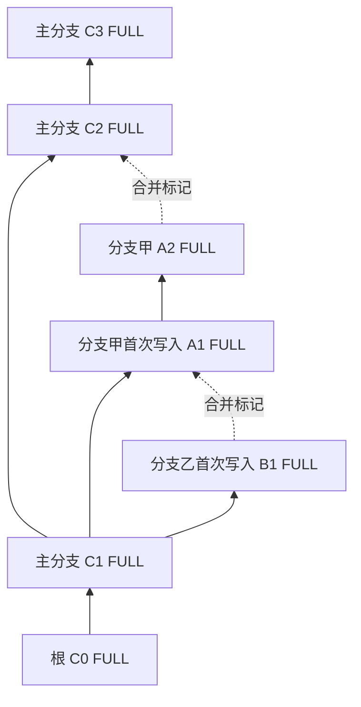
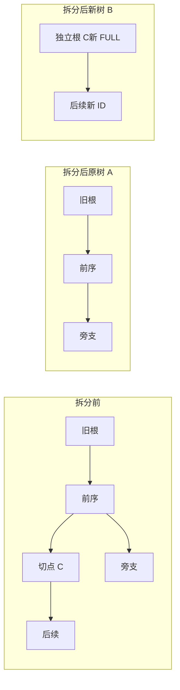

# 06 版本、分支引用、合并连线与树拆分

[文档目录](README.md) · [上一章：统一命名与路径规范](05-naming-and-paths.md) · [下一章：数据模型、身份与索引](07-data-model.md)

<a id="s06"></a>

版本演进、文件引用与首次写入、稳定目录分支及不可变子树、关系标记和历史树拆分。文件分支绑定稳定 file_id；目录分支组合共享文件分支，具有稳定 ID 和名称。目录修改或切换子项只生成不可变子树，不自动增加命名分支。磁盘只提供文件入口和副本位置。完整行为规则见[分支与目录子树](design/branch-system-logic.md)。

## 本章目录

- [6.1 版本演进与合并连线分别记录](#s06-01)
- [6.2 主分支、待写入分支与完整内容](#s06-02)
- [6.3 操作矩阵](#s06-03)
- [6.4 从历史节点继续保存](#s06-04)
- [6.5 多会话与并发基线](#s06-05)
- [6.6 入口绑定与分支切换安全](#s06-06)
- [6.7 历史读取、导出与恢复](#s06-07)
- [6.8 旧关系标记与文件分支合并](#s06-08)
- [6.9 树拆分与独立性](#s06-09)
- [6.10 操作前置条件与结果对照](#s06-10)

<a id="s06-01"></a>

## 6.1 版本演进与合并连线分别记录

每棵历史树有独立 history_tree_id 和一个根。根提交没有父节点，后续内容提交只有一个父节点，父节点必须已存在于同域，版本演进父边保持无环。分支仍记录其分叉来源。[S02]

旧的关系标记 `MergeLink` 另存为两个已有版本之间的关系线，不修改版本的 parent_commit_ids。文件分支合并会推进归属分支并同步目录引用，详见[合并、标签和备份前缀](design/file-merge-tags-backup.md)；目录分支合并待确认。

普通内容提交的父数不限制统一文件节点图：路径、标签和合并节点复用正文，`parent_node_ids` 可以表达多条无环来源边；`FileBranchMerge` 另存完整合并来源，不改写原正文证明。



实线表示版本演进，虚线只表示用户记录的合并关系。示例中的 C2、A1 均是已有版本，连线后内容不变，也不要求目标是分支最新版本。只有分支记录、尚未写入的来源引用不作为真实内容版本节点加入版本树。

<a id="s06-02"></a>

## 6.2 主分支、待写入分支与完整内容

```json
{
  "branch_id": "br_00000000000000000000000000000002",
  "history_tree_id": "history_00000000000000000000000000000001",
  "name": "方案甲",
  "head_commit_id": "commit_00000000000000000000000000000002",
  "fork_commit_id": "commit_00000000000000000000000000000001",
  "branch_kind": "file",
  "file_id": "file_00000000000000000000000000000001",
  "pending_file_versions": {"file_00000000000000000000000000000001": "ver_00000000000000000000000000000001"},
  "generation": "1",
  "state": "active"
}
```

文件分支明确绑定一个 `file_id`，同一文件可以拥有多个并行分支。文件详情显示其当前分支和历史版本，不能让用户先切整个硬盘或目录再访问文件。磁盘、备份路由与文件分支分别建模，分支身份不随展示名或文件路径改变。

创建文件分支只发布分支记录和冻结来源版本 ID，不读取或复制来源正文、不新建空文件，不增加 FileVersion、内容版本序号或保护回执。来源须是同文件同授权历史的真实元数据，已清除正文也可登记。Branch.pending_file_versions 表达当前继承归属，Commit.pending_file_versions 保留历史快照当时的继承关系；首写后旧快照仍显示原父版本，不随父 HEAD 变化。

待写入分支的选择也保留元数据例外：`select_file_branch` 和 `select_file_branch_at` 允许冻结来源正文缺失，不因此要求重新建立副本；非 pending 自有正文选择仍须有有效副本。选择成功不等于来源健康，实际读取无健康同版本副本仍明确失败。[增量发布与巡检](adr/0005-incremental-publication-integrity.md)不得将此例外取消或扩大为损坏元数据、新正文保护的豁免。

用户选择待写入分支后，该文件尚未拥有自己的正文，但可见内容为创建时冻结的父版本，大小和版本 ID 均按父真实版本显示；`PENDING` 仅表示归属，读取状态另见 `visible_content_state`。后续真正上传或写入才生成新的 FULL 版本，结束继承状态并保留来源谱系。首次写入即使为零字节或与来源同摘要，也建立独立版本，不能走普通未变内容的 no-op 路径。其他文件的路径、版本与分支选择保持不变。尚未写入时父版本可读即可下载和预览；范围写入以父版本为基础保留未修改字节，超出 EOF 的空洞补零。活动继承分支固定所需父正文，首次写入后且无其他引用才可清理父内容。

目录分支显式登记稳定身份和名称，直接引用父目录的已有子树，不伪造自有子树、不提前为后代文件创建分支、不新建空文件。目录不持有私有文件节点或分支；仍继承父节点的文件首次实际写入时，才为被写文件产生公共文件分支及真实内容节点。只有用户显式创建才增加命名目录分支，普通修改追加子树且保持分支身份和名称。登记与选择是分开的操作。

目录分支 head 指向不可变子树；文件修改、子项分支切换，以及新增、删除、移动、重命名都会生成必要的新子树。子树记录完整组成、名称、稳定身份和具体节点，最新在上、旧的在下。切换目录恢复目标子树的完整组成，不能将另一分支新增的文件混入，也不能只处理当前仍存在的条目。目录和文件改名保留稳定身份，旧树保留原名称及路径。

从目录 a 的 m 分支移动文件到目录 b 的 l 分支，两侧各生成记录移出、加入的子树；a.m 停止跟踪，b.l 接管后续跟踪，实体容器迁到 b，文件身份与所选内容节点不变。未选分支仍保留原逻辑路径、当前子树和具体版本，通过稳定身份读取 b 中的实际材料。移动、复制、删除、重命名均支持显式批量选择作用分支，不能隐式修改所有分支。源、目标配对与批量发布规则见[逻辑详解第 23—24 节](design/branch-system-logic.md#s23)。

根目录默认目录分支可由已认证的唯一管理员显式选择，SMB 经稳定主命名空间读取该默认组合；这不更换 SMB 共享绑定。兼容整树入口只登记元数据和冻结文件引用。旧 FULL 分支、已发布回执与证明保持原样，不迁移或改写。

<a id="s06-03"></a>

## 6.3 操作矩阵

| 操作 | 行为 |
| --- | --- |
| SMB 普通保存 | 使用用户选择的默认目录视图，按文件的继承或明确目标保存，并生成必要目录子树 |
| Web 普通保存 | 在该文件选中的分支建立新的完整文件版本；其他文件不变 |
| 从文件历史节点保存 | 建立分支记录，实际写入该文件时生成新 FULL 版本；不改写旧节点或其他文件 |
| 显式创建文件分支 | 仅记录 file_id、来源版本和冻结来源引用，不复制正文、不增加内容版本 |
| 切换文件分支 | 改变本文件引用并在所在目录生成子树；明确选择后写入该目标，其他文件引用不变 |
| 创建目录分支 | 登记稳定命名分支并引用父子树，不提前创建文件分支或自有子树，不复制正文或新建空文件 |
| 切换目录分支 | 恢复目标子树完整组成，范围外不变；父目录中的子目录引用变化生成必要子树 |
| 跨目录移动 | 选中源分支记录移出并停止跟踪，选中目标分支记录加入并接管跟踪，实体迁到目标目录，未选分支不变 |
| 批量复制 | 源只读取，副本获得独立文件身份并存入目标目录，所选目标分支记录加入 |
| 批量删除 | 只在所选分支移除条目并停止跟踪，不清除其他分支仍需读取的实体和版本 |
| 批量重命名 | 只在所选分支保存新名称及子树，稳定文件身份与正文不变，未选分支仍用旧名 |
| 旧关系标记 `MergeLink` | 固定两个已有节点，只记录关系线，不推进分支或目录引用 |
| 文件分支合并 `FileBranchMerge` | 明确参与分支、结果节点与归属，复用正文并推进参与引用；其他输入转为只读历史别名，详见[补充规则](design/file-merge-tags-backup.md) |
| 历史内容清除 | 清除获准版本的实际内容，保留节点与墓碑；不影响其他完整版本 |
| 树拆分 | 所选节点及全部后代迁入新独立历史域；两侧内容和恢复材料各自完整 |
| rebase / 强制重置 / 静默冲突覆盖 | 普通接口不提供 |

<a id="s06-04"></a>

## 6.4 从历史节点继续保存

浏览或比较文件历史不创建分支。用户从某个文件历史版本继续工作时，为该文件登记待写入分支，记录所选版本为谱系来源；新分支初始没有自己的内容版本。原版本和该文件的其他分支不变，同目录其他文件也不改变。

创建文件分支只需要可信的同文件来源元数据和必要父目录描述，不要求来源正文存在。来源引用不能伪装为零字节 FULL；未写入期间读父版本，父可用时可下载和预览。来源正文此前已清除仍可登记分支，但继承读取如实返回已清除；完整上传可写入全新内容，原墓碑保留。尚未成功发布的修改保留为待处理工作区。

新分支创建成功后，后续保存继续推进该分支，不每次重建分支。从一个已存在分支的当前 HEAD 正常保存与从旧历史节点保存是不同操作，接口和界面都必须明确来源。

<a id="s06-05"></a>

## 6.5 多会话与并发基线

存储池只有一个有效写协调器，但允许多个已认证 SMB 会话同时访问主分支。不能因为一个用户打开文件，就让整个主分支永久只供该用户写入。

第一版按文件仲裁写入：同一文件的有效写入占用、SMB 共享模式和字节锁由服务端统一核对，不兼容的写入返回忙或冲突；不同文件可并行编辑。分支目录提交串行发布，命名空间操作在同一受控顺序中处理。

保存核对基础文件版本、涉及目录项和会话代际。其他会话仅修改无关文件时，协调器可在重新验证所选内容及命名空间未变后，接到最新 HEAD；涉及同一文件或相关目录已变化则返回冲突，保留修改，禁止覆盖。显式整批工作区仍使用固定 expected_head，不自动调整输入。合并连线固定所选节点 ID，不要求节点仍是分支 HEAD。

会话具有受控代际与 fencing_token。租约过期、服务重启或撤销后，旧 token 不能发起新提交。拆分和拓扑切换使用短期分支或历史域维护锁，先处理相关脏工作区，不将维护锁混同于普通 SMB 客户端的长期写权。

<a id="s06-06"></a>

## 6.6 入口绑定与分支切换安全

SMB 共享绑定稳定的主命名空间。已认证的唯一管理员选择根目录默认组合后，SMB 读取该默认内容；该操作不改变共享所属历史或绑定 branch_id。调整共享归属仍须单独配置、处理旧会话并推进共享代际，不能在开放句柄期间换树。

受控 API 工作区绑定明确历史树、分支和基础提交。切换前检查未保存数据及开放写入；先完成、保留、导出或明确放弃，不能把旧分支脏内容自动送到新分支。Web 只管理元数据和引用，不提供正文上传、下载或预览。

<a id="s06-07"></a>

## 6.7 历史读取、导出与恢复

历史内容仍可用时，可以读取、预览、比较和导出。需要从历史状态继续编辑保存时，建立新分支；目录历史保存先预览目录元数据和变更清单，再原子发布分支记录与实际写入的 FULL 版本。只有工作区真正 staged 的文件产生内容版本，其余来源文件保留冻结引用，不隐式复制。旧 `MergeLink` 只作关系标记；明确采用已有节点作为当前结果则使用文件分支合并，两者不能混称。

PURGED 节点可浏览元数据，不承诺恢复字节。外部副本只能通过显式导入恢复为新版本，保留原节点曾清除的审计事实，不能通过恢复历史文件恢复已撤销的会话。

<a id="s06-08"></a>

## 6.8 旧关系标记与文件分支合并

本节原有画线操作作为 `MergeLink` 关系标记保留。用户新增的文件分支合并是独立操作：选择参与分支、该文件的任意结果节点并确认归属；结果等于任一输入分支头时直接复用，否则新增复用所选正文的合并元数据节点。其他参与分支转为只读别名，相关目录当前分支生成后续子树，旧子树冻结。完整规则及标签继承、历史标签编辑见[最新补充](design/file-merge-tags-backup.md)。以下“连线”仅描述旧关系标记，不限制新合并功能。

在历史图中选择一个分支上的版本，再选择另一分支的某个已有版本，拉一条线表示合并关系，保存该关系记录即可。目标可以是历史版本，不要求是最新版本；要表示与多个分支的关系时，分别连接相应版本。

旧 `MergeLink` 仅做这一项标记：不合并、复制或覆盖文件，不比较内容，不要求解决冲突，不创建新版本或目录快照，不改变两个分支的 HEAD，也不触发全量保存或新增内容副本。分支现有的未保存修改不因画线而提交。

连线固定到所选版本，后续任一分支继续保存都不移动它。即使端点文件内容已经清除，只要历史节点仍在，也可以记录和显示连线。连线随历史元数据保存，不因刷新界面、服务重启或端点内容清除而消失。

版本演进和合并标记分别管理。连线不参与版本父边的无环约束、不形成文件读取依赖，也不改变树拆分的后代范围。实际修改文件仍按普通保存规则执行。

<a id="s06-09"></a>

## 6.9 树拆分与独立性

以下定义拆分必须满足的独立性要求。当前核心不支持拆分含目录组合的历史；执行前核对[核心限制](components/engine.md)与预览结果，不能以管理表单存在推断操作可执行。

默认选择非根提交 C，B 为 C 及全部沿父到子边可达的后代，A 为其余节点。A 保留原根、前序和不属于 B 的旁支；B 迁到新 history_tree_id，C 的副本成为新根。后代范围只沿版本演进父边计算，不沿合并标记线扩展到其他分支；预览展示完整迁移范围及涉及的连线，不能按界面折叠区域裁切。选择原根使 A 为空，因此拒绝并提示整树迁移。



新树的提交、目录、文件、版本和分支映射为新 ID，保留作者、原时间、内容哈希和来源映射。内部父边映射到新 ID；跨界父边只留审计摘要，不成为可解析的跨树父引用。两个端点都留在同一结果树的合并连线在该树保留并映射节点 ID；横跨拆分边界的连线改为各侧文字来源记录，不保留需要访问另一树的活动连接。

提交的命名空间删除事实随拆分逐项复制，保留原时间、路径、种类和实际效果顺序，不因新树缺少切点父提交而丢失。它不引用被删除文件或正文，也不扩大新树的内容保留和复制集合；导出、恢复后的活动记录直接读取提交事实，不依赖操作回执或父子快照差分。

新树仍需保留的全部文件实际复制为自己的完整文件，不用硬链接、reflink、共享对象目录或另一树的内容补齐。原树继续需要的完整版本也必须留在本域。已清除历史迁为墓碑，不伪造字节；拆分后的活跃结果缺必需内容则拒绝。

两树独立拥有分支、策略、配额账本、检查点导出和内容引用集合，可共用物理盘及池级全部配置成员日志和协调器。删除一树不能破坏共享控制记录；每树恢复包自包含，初始可复制原策略，后续分别管理。独立指可单独导出、恢复、清除和归档，不表示自动分配另一台服务器或电源。

有无法安全处理的脏工作区或句柄时返回 SPLIT_BUSY。拆分固定结构代际、受影响 HEAD、租约和清除计划，准备两侧内容及检查点，再以一个存储池事务同时激活新树并迁出原树后代。发布前保持旧状态，发布后按新映射处理；受影响会话返回 TREE_MOVED 并重新授权，不能存在已发布的一半状态。

全部活动分支迁走时，原树保留前序并归档，不自动删除历史，也不强制创建新分支。需要提供当前目录或 SMB 共享的树必须明确指定主分支；若原共享的主分支已迁出，应停止该共享，待显式设置归属并重新授权后再开放。新树是否开放 SMB 由用户明确配置，原共享不得自动重定向。历史拆分不自动改变备份来源树。验收需分别隔离另一树对象进行恢复，并返回迁移范围、ID 映射、已清除节点、空间预算及两树状态。

迁入新树的已归档分支保持归档状态。新树优先采用迁入的活动分支作为主分支；若没有活动分支，则在新根登记名称不冲突的活动主分支，不复活已归档分支，也不自动开放 SMB。

<a id="s06-10"></a>

## 6.10 操作前置条件与结果对照

| 操作 | 必要条件 | 必须得到的结果 |
| --- | --- | --- |
| 在已有分支当前状态保存 | 目标业务状态可写，文件及目录前置条件有效，指定副本和容量满足 | 变更文件形成新的完整版本，原历史保留 |
| 创建分支 | 同文件来源元数据可信、目标可写范围及元数据容量满足 | 分支记录和独立冻结来源引用；不读取来源正文、不新增版本 |
| 从历史状态继续保存 | 来源元数据有效，实际修改位于明确工作区；实际写入满足 FULL 与路由条件 | 新分支只为实际写入文件生成完整版本，其他文件继续引用父版本；后续保存继续该分支 |
| 记录合并连线 | 所选历史节点存在，节点归属与关系有效 | 仅保存固定端点的关系记录；不要求内容可读、分支处于最新状态或先保存脏数据 |
| 合并文件分支 | 参与分支可写、各head基线未变、所选正文可验证，用户确认结果与归属 | 推进归属和参与目录引用；保留所有来源、旧树与只读别名，不新增FULL；规则见[补充说明](design/file-merge-tags-backup.md) |
| 清除历史内容 | 影响范围已明确，预览和后果已明确确认，活动引用已解除或结束 | 内容墓碑和清理清单生效，历史节点及合并连线保留 |
| 拆分历史树 | 切点为非根节点，实际后代范围固定，必需内容和独立恢复材料可准备，维护条件满足 | 原树与新树同时公开，活动跨树内容依赖被切断 |
| 归档分支或历史树 | 当前管理员认证有效，工作状态已处理 | 按归档策略停止活动使用，历史及内容保留状态分别管理 |

[S02]: https://git-scm.com/book/en/v2/Git-Branching-Branches-in-a-Nutshell

---

[文档目录](README.md) · [上一章：统一命名与路径规范](05-naming-and-paths.md) · [下一章：数据模型、身份与索引](07-data-model.md)

最新确认的文件／文件夹改名规则：增加目录子树，并为每个受影响文件增加公开的文件路径节点；节点引用原正文，不生成新 FULL。后续实际写入接在该路径节点之后。路径节点可独立备注或作为创建文件分支的来源，分支标签改名仍不增加节点。见[详细规则](design/branch-system-logic.md#s15)。
