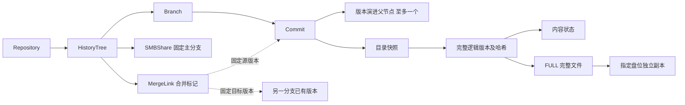

# 07 数据模型、身份与索引

[文档目录](README.md) · [上一章：版本、分支引用、合并连线与树拆分](06-history-and-branches.md) · [下一章：全量存储、盘格式与单盘恢复](08-full-storage-and-disk-format.md)

<a id="s07"></a>

核心实体、稳定标识、对象关系及索引重建依据。

## 本章目录

- [7.1 核心实体与身份](#s07-01)
- [7.2 对象与引用图](#s07-02)
- [7.3 SQLite 的职责](#s07-03)
- [7.4 权威事实来源的层次](#s07-04)

<a id="s07-01"></a>

## 7.1 核心实体与身份

| 实体 | 必需字段 | 约束 |
| --- | --- | --- |
| Repository | repository_id, name, name_policy, unicode_version | 命名与配额容器不等于单一历史域；不保存用户 ACL |
| HistoryTree | history_tree_id, repository_id, root_commit_id, main_branch_id, generation, state, quota_id | 提交谱系、公共文件混合节点 DAG 与独立关系标记；独立内容账本和恢复包；仅保留历史且无活动分支时 main_branch_id 可为空 |
| Branch | branch_id, history_tree_id, head_commit_id, fork_commit_id, branch_kind, generation, state；可选 file_id、pending_file_versions | file 分支绑定单文件，full 为兼容目录快照；pending 映射记录未写文件及来源，创建不复制正文 |
| Commit | commit_id, history_tree_id, kind, parent_commit_ids, tree_id, sequence, operation_id, namespace, provenance；可选 pending_file_versions、namespace_deletions | namespace 是有界不可变分页根（namespace-page/namespace-index 对象）加记录条目总数（[ADR 0011](adr/0011-paged-namespace-roots-and-segmented-logs.md)）；快照固定当时待写文件及来源，不随Branch首写清空；根和 split_root 零父，其他版本提交一父；合并连线不改父列表 |
| MergeLink | merge_link_id, history_tree_id, source_branch_id, source_commit_id, target_branch_id, target_commit_id, author, created_at, operation_id | 两端为选定的已有版本；无结果版本、目录快照或内容依赖 |
| FileMetadataNode | node_id, file_id, version_id, parent_node_ids, branch_id, kind, tags, sequence | 标签或合并子节点复用真实正文；标签快照不可变，不制造 FULL |
| FileBranchMerge | input_branch_ids, input_node_ids, chosen_node_id, result_node_id, surviving_branch_id, reused_node, parent_node_ids | 完整来源独立保留；复用输入头时不新建节点，附加边不得成环；消耗分支记录只读别名 |
| ProtectionPolicy / file_backup_policies / file_backup_paths | 稳定策略范围、target_copies、必填 inheritable、每槽用户前缀、文件策略绑定与逐槽路径 | true 为现行 scope／路径规则；false 仅供文件绑定保留旧设置，不参加继承；份数含主盘，移动不重设绑定 |
| DirectoryTree / Entry | tree_id, entry_id, name, lookup_key, kind, file_id, version_id | 不可变目录语义，条目指向逻辑版本而非物理路径 |
| FileVersion | version_id, history_tree_id, file_id, logical_size, content_hash, checksum_manifest_hash, origin_commit_id, source_version_ids, version_sequence, creation_primary_slot_id, created_as_full_checkpoint | 逻辑描述不可变；内容状态另记事件 |
| FullPayload | payload_id, version_id, kind, content_hash, size | kind 固定 FULL；无基础版本、差异链或模式切换 |
| Replica | replica_id, version_id, payload_id, primary_slot_id, slot_id, copy_level, upstream_slot_id, route_slot_ids, topology_generation, binding_generation, disk_id, state | 本盘完整文件和校验有效，来源符合路由 |
| StorageSlot | slot_id, copy_level, disk_id, binding_generation, state | 每物理盘只绑定一个数据级别 |
| BackupTopology | topology_id, generation, slots, source_mappings, state | 相邻级别、无环、每源单后继；按代际发布 |
| PlacementBinding | version_id, primary_slot_id, target_copies, route_slot_ids, topology_generation, binding_generations, generation | 固定前 r 份的确切目标；变更显式迁移 |
| ContentState | version_id, state, purge_operation_id, deleted_at, reason | PURGED 与意外 UNAVAILABLE 区分，不删逻辑摘要 |
| ReplicaPolicy | scope, target_copies, primary_slot_rule, policy_generation | 冻结一级来源、份数和路由 |
| Workspace | workspace_id, branch_id, base_head, fencing_token, staged_items, namespace_events | 文件另记 dirty_generation、基础版本及目录前置条件 |
| OperationPlan | plan_id, operation_id, kind, expected_generations, request_digest, objects, state | fork / split / purge / topology-migration 可重试；合并连线直接记录，不走内容计划 |
| Transaction | transaction_id, operation_id, decision_slot, candidate_hash, participants, policy_snapshot | 可包含多树发布；同槽位一个候选 |
| AccessSession / SMBShare | session_id, principal_id, generation / share_id, history_tree_id, main_branch_id, share_generation | 认证身份、用户选择和共享绑定分别验证 |
| Disk / Lease | disk_id, physical_identity / lease_id, fencing_token, scope | 设备身份、文件写入占用和维护租约分别验证 |

普通后续提交可继续引用本分支已有未变版本。新分支元数据快照可以引用真实来源版本，但 `pending_file_versions` 明确标记这些文件尚无本分支正文，不可将引用解释为已拥有内容。首次实际写入才生成独立 FULL 版本，未写入时从冻结父 version_id 读取；实际写入后的独立 FULL 仅以来源 ID 记谱系，不再依赖父字节。

Branch 与 Commit 的 `pending_file_versions` 采用当前稀疏编码：缺省表示空，空时省略序列化，确定性编码与非空映射往返均须核验；这不是旧格式自动迁移。已物化 FULL 分支不转换为待写入状态。持久 Commit 的文件条目仍引用真实来源版本，不写入空版本 ID；`Engine::list_tree` 和历史视图保留可见真实版本及大小，未写入文件为冻结父版本。文件管理 JSON 附 `materialized:false`、`inherited:true`、`own_version_id:null`、`content_state:"PENDING"` 及实际 `visible_content_state`；Entry 的 JSON 字符串编码保持兼容。旧继承快照始终按自身映射读取冻结父内容，不能在当前 Branch 首写后显示新写版本。

`Entry.kind` 与删除事实的 `kind` 在核心中统一使用 `NamespaceEntryKind::{File, Directory}`。信任边界是快照、历史包及 RPC JSON 的反序列化：只接受字符串 `"file"` / `"directory"`，拒绝未知值、非字符串及 `{"file":null}` 枚举对象。内部命名空间构造、查询和删除依赖枚举保证，不再重复验证 kind；目录载荷、路径及引用关系仍在相应边界验证。有效 JSON 的规范字节与哈希不变；历史提交类型、界面展示类型和 SMB OpenResult 不属于此枚举。

`Commit.namespace_deletions` 是与正文独立的命名空间删除事实：无删除时省略；存在时包含 UINT64 十进制字符串 `timestamp` 和非空 `paths`。每项仅含 `path` 与 `kind`（`file` 或 `directory`），按实际操作效果顺序保存；同一路径删除、重建后再次删除是不同效果，不排序或去重。时间必须能表示有效 UTC 时刻，由核心语义校验；UInt64 字段形状不代替此约束。时间随提交持久化，导出、恢复及历史拆分不依赖操作回执补齐。事实不带 entry/file/version ID 或正文引用，不增加正文保留根；纯重命名、移动及目录视图选择不产生删除事实。

工作区另保存可选的 `selected_file_branches`，固定创建时的文件选择；两个待写入分支可以共用同一个来源 ID，不能只靠基础版本相同便把旧工作区写入另一分支。

creation_primary_slot_id 是创建时审计归属；当前实际归属和路由以 PlacementBinding 代际事件为准，迁移不改逻辑版本字节。

<a id="s07-02"></a>

## 7.2 对象与引用图



version_sequence 是本域递增的逻辑版本序号；拆分按确定次序重新分配并保留来源映射。历史拓扑根与内容保留根分别管理：旧提交可以指向 PURGED 墓碑，不能因历史可达就推导文件内容必须永久存在。

<a id="s07-03"></a>

## 7.3 SQLite 的职责

当前实现仅保存文件历史候选表 `file_history_versions`、其 `(file_id, version_sequence_key, version_id)` 查询索引和 `current_state` 发布序号标记，不维护通用实体 JSON 或完整 State 镜像。路径、分支、节点关系、副本位置、任务和事件等读取仍使用恢复后的 State 及对应业务路径，不能将这些读取视为已有 SQLite 索引消费者。

索引由本地单写者更新，类型化版本行与发布序号在同一 SQLite 事务中提交。仅非索引元数据变化时仍推进序号；候选查询核验完整性后从 State 取得完整版本对象，不能以 SQLite 行作为业务或授权依据。具体字段、适用规模及失败回退见[文件历史候选索引](19-capacity-and-performance.md#s19-11)。

SQLite 的 `journal_mode=WAL` 只控制本地写前日志，不协调其他盘的普通文件发布，不提供本系统的跨盘提交判断。[S11]

SQLite 丢失或损坏后，由有效检查点、应用日志和不可变元数据重建；不能在数据库缺失时把已有数据盘当成空系统初始化。

<a id="s07-04"></a>

## 7.4 权威事实来源的层次

```text
业务提交决定：已验证的应用事务日志及检查点
可重放公开结果：PUBLICATION、保护回执及公开变更清单
业务快照内容：不可变 Commit / Tree / FileVersion、路径及元数据节点、旧关系标记、文件合并来源、清除和拆分事件
物理内容存在性：指定级别和来源路由 + 本盘完整文件及证明 + 内容校验
在线加速查询：SQLite 索引
客户端体验：缓存、通知、活动面板
```

物理文件存在不自动证明已业务提交；索引有一行不自动证明全部副本可用。恢复必须交叉核对。

[S11]: https://www.sqlite.org/wal.html

---

[文档目录](README.md) · [上一章：版本、分支引用、合并连线与树拆分](06-history-and-branches.md) · [下一章：全量存储、盘格式与单盘恢复](08-full-storage-and-disk-format.md)

### 持久内容状态的封闭词汇

State 的 `content_states`、历史包同名映射和正文墓碑使用同一个 `ContentState` 类型，仅接受字符串 `AVAILABLE`、`PURGED`、`MIGRATED`。大小写别名、未知字符串、对象形式和其他 JSON 类型均拒绝；墓碑仍额外限制为 `PURGED` 或 `MIGRATED`，不能以 `AVAILABLE` 绕过墓碑验证。状态缺省时不补写映射项，读取按已有的可用正文规则处理；版本接口的缺省值也输出规范的 `AVAILABLE`。

这些枚举值的规范 JSON 字节与原字符串相同，State 页、历史包及墓碑的内容哈希和证明覆盖规则不变；原始证明页继续保留原 JSON，而不是反序列化后重建证明。文件或分支视图的 `LIVE`、`PENDING` 是展示与继承状态，不属于持久正文状态。实时副本健康也不是 `ContentState`，磁盘身份、发布证明、内容校验和授权检查仍按原边界执行。
