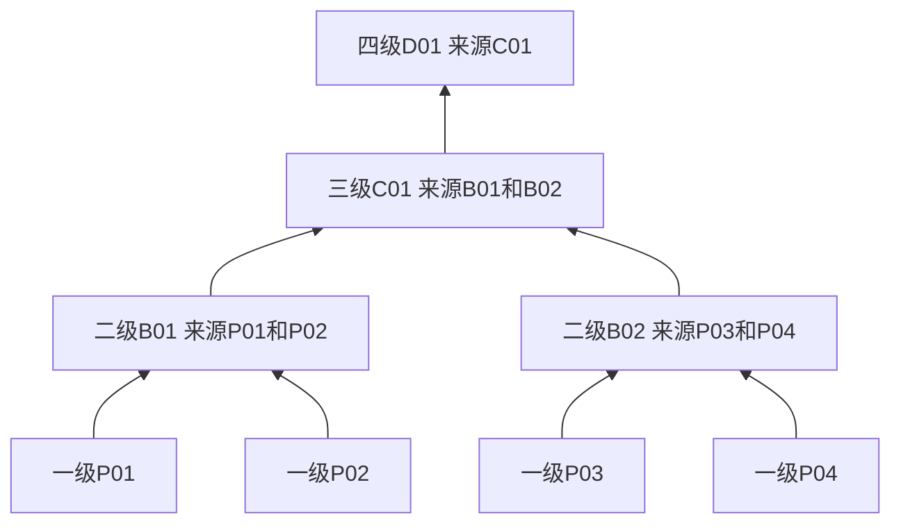

# 09 用户指定的分层备份拓扑

[文档目录](README.md) · [上一章：全量存储、盘格式与单盘恢复](08-full-storage-and-disk-format.md) · [下一章：事务、持久化与崩溃恢复](10-transactions-and-recovery.md)

<a id="s09"></a>

一级归属、固定来源、逐级副本、等级调整和拓扑迁移。

[每个备份盘独立指定逻辑路径前缀](design/file-merge-tags-backup.md#backup-prefix)。路径为用户前缀加策略范围内相对路径，不从主盘真实路径推导；份数和路径绑定稳定文件身份，主盘移动不重设。显式配置可为既有可用版本补足副本，不新建正文版本。

## 本章目录

- [9.1 n块盘的角色与“保存几份”](#s09-01)
- [9.2 来源固定的汇聚树](#s09-02)
- [9.3 稳定盘位、目录绑定与拓扑校验](#s09-03)
- [9.4 一级归属与确定性路由](#s09-04)
- [9.5 每级过滤、来源证明与副本计数](#s09-05)
- [9.6 完整副本与低保护历史的边界](#s09-06)
- [9.7 保留版本、等级调整与树拆分](#s09-07)
- [9.8 混合等级提交与代际冻结](#s09-08)
- [9.9 复制路径、故障读取与修复](#s09-09)
- [9.10 拓扑迁移、换盘和排空](#s09-10)
- [9.11 容量、告警与固定来源限制](#s09-11)
- [9.12 元数据保护与两种“树”](#s09-12)
- [9.13 规则继承与既有版本的适用范围](#s09-13)

<a id="s09-01"></a>

## 9.1 n块盘的角色与“保存几份”

除系统盘外最低只需一块存储盘，二级及后续所有备份层均可不配置。单盘模式无磁盘冗余；缺失唯一副本时不能保证恢复。用户登记n个存储目录，并显式划分数据盘位：m个一级盘位、c个二级盘位、d个三级盘位、e个四级盘位及后续级别；u个可保持未分配或备用。`n = m + c + d + e + … + u`。每个已分配盘位绑定一个存储目录；不同盘位可共享底层设备，不做物理关系拒绝，独立故障域由用户保证。元数据成员职责另按[第 9.12 节](09-backup-topology.md#s09-12)指定。

一级盘保存业务文件的第一份，不仅保存低保护等级文件。目标为1份的版本止于一级；目标为2份的版本保留一级第一份，并在其指定二级盘保存第二份；3/4份继续沿既定链增加。后续级别只包含其指定来源中需要达到该级的版本，不是上一级所有文件的无条件整盘镜像。

| 目标份数r(v) | 必须完成的数据盘位 |
| --- | --- |
| 1 | 指定一级盘P |
| 2 | P及用户指定的二级目标B |
| 3 | P、B及B的指定三级目标C |
| 4 | P、B、C及C的指定四级目标D |
| 更多 | 从该一级来源沿映射继续，每级一份，不跳级 |

这些份数包括原始存储，不是额外再加r份。只有每份实际处于不同物理盘且依赖完整时，才能声明对应设备级冗余；共同控制器、电源、软件和整机灾害仍是共同风险。

<a id="s09-02"></a>

## 9.2 来源固定的汇聚树

每个备份盘位显式列出上一级来源列表。二级B01可保存P01/P02中需要第二份的版本，B02可保存P03/P04中的相应版本；三级C01可保存B01/B02中需要第三份的版本；四级D01继续保存C01中需要第四份的版本。



该示例共8个已分配盘位，m=4、c=2、d=1、e=1；其余已登记盘可保持备用。箭头表示来源归属与复制方向，不表示历史提交父边。

首版每个源盘位在同一拓扑代际至多指定一个下一级目标；一个目标可接多个上一级来源，来源数由用户决定。按“备份盘为父、来源盘为子”观看就是汇聚森林，每个目标恰有两个来源时呈二叉形式；本设计不强制两个来源上限。需要同一来源在同一级扇出到多个目标时，须另扩展明确的份数/路由模型，不能把当前规则擅自解释为额外多份。

<a id="s09-03"></a>

## 9.3 稳定盘位、目录绑定与拓扑校验

slot_id表示用户指定的长期角色，例如P01、B01，copy_level分别为1、2。disk_id 与 seal 的 device/inode 绑定当前登记目录，不声明物理设备身份；更换B01的物理盘保留B01的来源职责，通过binding_generation区分旧新设备。设备路径和盘符不作为角色身份。

发布拓扑前必须检查：

1. slot_id唯一、每盘唯一绑定、copy_level为正整数，来源和目标均存在且已登记；备用盘不接受业务数据写入。
2. 一级盘没有上游来源；每个备份盘的来源非空，且全部来自紧邻的上一级；不跨级、不自指、不形成环。
3. 同一个源在同一代际最多出现于一个后继目标的source_slot_ids中；多个目标重复接管同一源必须拒绝。
4. 登记 ID、目录身份与路由绑定保持一致；不探测或拒绝同物理盘不同分区，物理冗余由用户保证。
5. 检查受影响现有版本的路由、目标份数、保留范围和实际空间。校验通过不等于数据已经迁移完成。

已发布拓扑以topology_id、topology_generation和完整映射哈希固定，写入全部已配置元数据成员的日志与检查点，并复制必要来源证明到各盘本地清单。用户修改形成新代际；不能原地改配置便让旧文件突然归属另一个来源。

<a id="s09-04"></a>

## 9.4 一级归属与确定性路由

用户为仓库/历史域/目录配置一级盘规则，或在创建、导入和拆分计划中逐项指定primary_slot_id。缺少可继承规则时返回PRIMARY_PLACEMENT_REQUIRED；不随机选择一级盘。规则选择的是一个确定盘位，变更规则只影响之后的新版本，既有版本迁移另行执行。

```text
route(v)[1] = PlacementBinding(v).primary_slot_id
route(v)[k+1] = 当前冻结拓扑中以route(v)[k]为来源的唯一目标
required_slots(v) = route(v)[1:r(v)]
```

若链只到二级，则该一级盘来源的版本最多支持2份，即使存储池有十块其他空盘也不能保存3份。能力协商同时报告存储池上限和每个一级来源的route_max_copies。新提交冻结完整路由、拓扑代际和各盘目录绑定代际；任一指定级缺失、离线、排空或空间不足即失败/等待，不跳过它用更高级或无关盘凑数。

改名和目录移动不自动改变既有 version_id 的一级归属。分支创建只产生元数据与来源引用；首次实际写入才创建版本，并按当次计划明确一级归属及路由。路径落到不同一级规则的目录后，界面显示“路径规则”和“既有实际归属”的差异；后续新内容版本按新规则放置。若要改变旧版本实际归属，用户须提交覆盖所有共享引用的显式迁移计划，或复制为新逻辑版本。

<a id="s09-05"></a>

## 9.5 每级过滤、来源证明与副本计数

每份业务副本记录primary_slot_id、slot_id、copy_level、直接upstream_slot_id、完整route_slot_ids、拓扑与目录绑定代际、版本/完整内容哈希。聚合盘B01同时存P01和P02的文件时必须按一级来源隔离索引，不能丢失来源身份；C01也能区分B01转来的内容原来属于P01还是P02。

第 k 级只接纳其指定来源中目标份数至少为 k 的完整版本；单份业务版本不能因为盘还有空间而被批量复制到二级。来源不在允许映射中的版本，或同版本多出一份在无关盘，均不算该路由的计划保护副本。暂存、迁移残留、缓存和未验证对象另标状态，不混入达标数量。

健康达标要求 required_slots 中每个盘位都持有同一版本的完整文件、校验及本盘证明，状态为 COMPLETE_VERIFIED；该状态只证明登记盘位上的完整材料，不证明物理设备不同。总数看似达到 r 而缺少指定二级、重复一级或多出无关三级，仍不达标。目标、各级实际状态及总体保护结果同时展示。

<a id="s09-06"></a>

## 9.6 完整副本与低保护历史的边界

每个指定盘位都保存当前版本的完整普通文件，不能只保存差异或从另一盘取得缺失范围。备份级别是份数和来源职责，不能理解为不同级别保存不同内容片段。

旧 V1 只要求一份、新 V2 要求两份时，V1 仍留在其一级盘，V2 的完整文件分别存到指定一级和二级。V2 不依赖 V1，因此无需为保存 V2 擅自增加 V1 的备份份数。后续清除 V1 内容不影响 V2。

复制、修复、分支首次内容写入和拆分均遵守相同来源准入；仅登记引用不生成业务副本。合并连线没有新增文件，不改变备份份数或路由。即使从三级健康副本读取数据修复一级目标，也不改变该版本的一级归属或备份角色。

<a id="s09-07"></a>

## 9.7 保留版本、等级调整与树拆分

同一完整 version_id 可在本分支的多个连续提交中出现，其当前 PlacementBinding 唯一；不同保留视图提出保护要求时，取仍有效要求的最大值，并在确定路由上满足。分支首次写入后拥有自己的版本和完整文件；未写入文件通过元数据和来源引用读取冻结父版本，不把同一父版本重复计为新版本或新增副本；活动继承仍固定所需父正文。改变保留版本的实际归属须显式迁移并展示所有受影响视图，或复制为新版本。

提高份数时，先验证链深及每级容量，为当前和历史适用版本分别准备完整副本，完成前显示UPGRADING。降低份数需要授权和宽限，按原路由从最高多余级开始回收；不能因为分支归档、来源盘离线或目录移动自动降低。

新分支只在实际写入各文件时，按目标目录已有一级规则或计划指定的一级盘放置本次 FULL；未写文件读取父版本已有路由，不新增自有正文路由或独立内容预算。合并标记不生成业务副本，也不重新分配端点已有文件。树拆分复制新的业务对象和恢复包，可沿相同已批准的盘位路由放置；这不构成跨树对象共享。若新树选择另一一级来源，预览必须明确新路由和全部完整副本占用。

<a id="s09-08"></a>

## 9.8 混合等级提交与代际冻结

一次提交可包含P01上的1份A、P02上的2份B和P03上的4份C。逐版本冻结一级盘、r(v)、完整required_slots、topology_generation、binding_generation及policy_generation，按这些确切盘位做空间预留和校验，不能用提交级一个r或自由候选集合代替。

进入决定槽位前复查全部代际。准备期间拓扑、一级规则或绑定改变则返回PLACEMENT_CHANGED，重新预览/准备；不得修改已开始持久化的候选。份数提高先补齐，降低仍保留本次已准备较高目标，之后按授权清理。来源归属、内容哈希及完整文件身份固定在同一候选中。

<a id="s09-09"></a>

## 9.9 复制路径、故障读取与修复

来源映射决定“谁的文件应存在哪个盘”，不强制网络/IO必须逐级串行传输。正常备份或修复可从同版本、同归属的任一健康副本读取，校验后写入**原路由指定的目标盘位**；即使从三级读回一级，也不改变二级/三级的来源职责或把其他来源文件混进该盘。

一级故障后可从指定二/三级健康完整副本读取，路径和版本身份不变；这只是故障读取，不把二级盘自动升格成一级。中间二级离线不影响已有健康三级文件的独立读取，但新3份严格提交仍须恢复其指定一级、二级、三级全部目标。新增写入不得绕过故障级别。

修复先复制/重建、核对最终哈希和来源、同步，再注册对应盘位副本；完成前不删除最后健康源。目标盘缺失或满时等待其恢复或由用户明确换盘/改拓扑；不选择其他空闲盘自动替代。内容不一致不按mtime决定，仍以可信版本描述和完整内容清单为准。

<a id="s09-10"></a>

## 9.10 拓扑迁移、换盘和排空

拓扑变化先创建计划，列出受影响一级来源、各级版本、全部保留历史文件、清除残留、目标空间和未来路由。准备新目标时旧拓扑仍权威；过渡期间可以保留旧新副本，但分代际记录。受影响来源在最终切换期间冻结写入并复查集合，按[第 10 章](10-transactions-and-recovery.md)一个事务激活新拓扑及受影响版本的放置绑定，不能只改映射而让文件留在旧目标却显示合规。

同槽换物理盘保留slot_id、copy_level和来源列表，显式提升binding_generation。先验证新登记目录身份和数据准备，原子切换后旧盘隔离；物理盘永久失效时可从任一同归属健康级恢复到用户指定的替换盘，不把源读取位置误记为新的业务一级来源。

排空无法在当前映射内完成时，必须先审查盘位替换或拓扑迁移；未分配/备用盘不能被自动纳入放置。旧目标的残留依引用与清除计划回收，离线盘重新插回先查拓扑/绑定代际和墓碑，不复活已迁走或已清除内容。

<a id="s09-11"></a>

## 9.11 容量、告警与固定来源限制

每级盘的容量按其确切来源和进入该级的版本计算。B01的需求来自P01/P02中r≥2的版本，C01来自B01/B02中r≥3的版本；不是每盘平均分摊存储池数据。一个备份盘汇聚多个来源时，预警应显示各来源占用和增长，避免来源总需求超过该盘。

指定B01满而无关B02空，仍不能让P01的第二份落到B02；返回对应slot/level/source的NO_SPACE或ROUTE_TARGET_UNAVAILABLE。可以由用户迁移拓扑后重试，不能把存储池剩余空间作为该来源的可写预算。自动容量均衡只提供建议和计划，不自行改变源/目标关系。

<a id="s09-12"></a>

## 9.12 元数据保护与两种“树”

应用日志、控制检查点和拓扑配置的成员由用户显式选定，数量 N 至少为 1，可与业务盘角色共盘；成员可以共享底层设备；物理故障域由用户保证，成员数不自动等于独立设备数。例如单盘配置只选择 P01，也可选择 P01、B01、C01 三成员；其余来源映射不会因此自动变化。正常发布须全部已配置成员完成，相应恢复/准入固定要求 floor(N/2)+1 个原始成员，不按在线数重算。业务版本只保存1份，不代表已配置的三成员日志自动降为1份；元数据不作为其他来源的业务payload写入。

盘位来源树与版本演进父边、合并标记分别管理。历史分支创建、合并和拆分不自动重画盘位来源；修改备份拓扑也不改变提交父边。固定来源的在线多份保护仍共享本机故障域，不能替代脱离工作盘的外部备份。

<a id="s09-13"></a>

## 9.13 规则继承与既有版本的适用范围

一级盘规则及目标份数按配置作用域继承。保存新内容、分支首次写入或导入时，必须解析本次目标规则并冻结实际路由；只登记引用不复制来源文件。

改名与目录移动不自动迁移既有版本的实际盘位。修改规则时，预览必须区分“仅后续新版本”和“同时处理选定保留版本”；后者形成显式迁移或保护调整任务。不得因路径变化、归档或故障自动降低已承诺份数。

若同一保留版本仍受多个有效保留要求约束，其目标取这些要求的最大值。已实际写入的分支内容拥有自己的版本和放置绑定，不通过修改源分支策略改变另一分支已经创建的文件。

当前 `backup-configuration` 显式回填所覆盖文件的可用历史版本。scope 的现行规则保持原 ID 并推进代数；本次覆盖范围外仍绑定旧规则的文件共用一份 `inheritable:false` 的保留设置，其已绑定份数和备份路径不变。只有 `inheritable:true` 的现行 scope／路径规则参与后续继承；保留设置只由文件绑定使用，父目录重配不能覆盖它。无引用保留设置清理，空 scope 的现行规则保留。通用 `PUT /api/policies/{policy}` 只接受无稳定 scope 的现行路径规则，不回填历史；稳定 scope 与保留设置直接更新会被拒绝。字段与导入／拆分边界见[备份规则](design/file-merge-tags-backup.md#backup-prefix)。

---

[文档目录](README.md) · [上一章：全量存储、盘格式与单盘恢复](08-full-storage-and-disk-format.md) · [下一章：事务、持久化与崩溃恢复](10-transactions-and-recovery.md)
