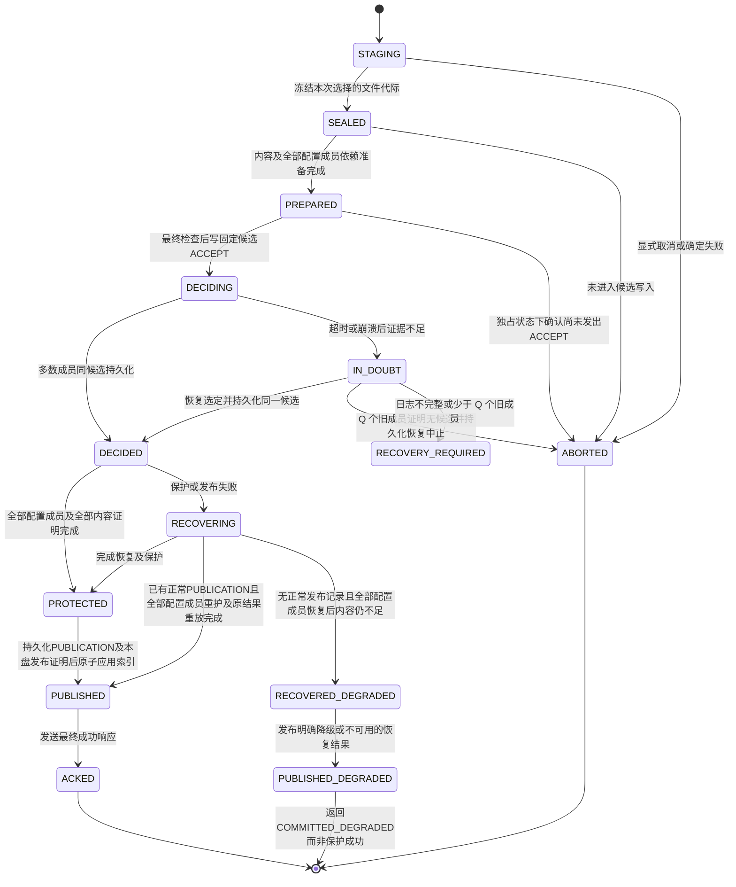
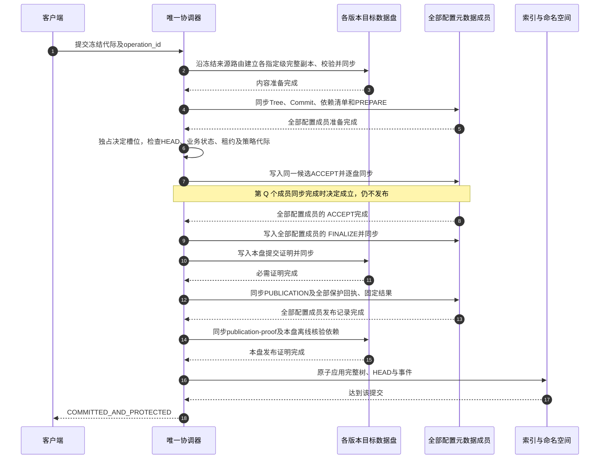

# 10 事务、持久化与崩溃恢复

[文档目录](README.md) · [上一章：用户指定的分层备份拓扑](09-backup-topology.md) · [下一章：文件写入与保存语义](11-write-semantics.md)

<a id="s10"></a>

保存状态、全部配置成员保护、决定证明和确定性恢复。

## 本章目录

- [10.1 区分接收、决定、保护与发布](#s10-01)
- [10.2 单写者、多数成员决定与全部配置成员确认](#s10-02)
- [10.3 持久化成功条件](#s10-03)
- [10.4 写入状态机](#s10-04)
- [10.5 提交时序与授权边界](#s10-05)
- [10.6 日志记录与证明](#s10-06)
- [10.7 Q 个旧成员上的确定性恢复](#s10-07)
- [10.8 必须覆盖的故障窗口](#s10-08)
- [10.9 检查点与 SQLite 快照](#s10-09)
- [10.10 发布证据、重放与历史结果](#s10-10)
- [10.11 全池阻塞与超时处置](#s10-11)

<a id="s10-01"></a>

## 10.1 区分接收、决定、保护与发布

| 状态 | 含义 | 能否表示已按目标副本保存 |
| --- | --- | --- |
| 客户端或工作区已接收 | 字节在缓冲或暂存中 | 不能 |
| 候选写入中 `DECIDING` | 有一个固定候选，可能只有一份 ACCEPT | 不能；超时查询原 operation_id |
| 决定成立 `DECIDED` | 同一候选的 ACCEPT 已在 Q 个不同元数据成员持久化 | 决定不可回滚，但还没有满足全部配置成员保护 |
| 保护完成 `PROTECTED` | 全部配置成员元数据、逐版本内容保护和本盘证明均完成 | 可以进入发布，尚不能提前响应成功 |
| 已发布 `PUBLISHED` | 本操作对应的公开状态与索引原子生效；内容提交同时推进 HEAD | 可以返回最终成功；响应丢失不改变事实 |

应用自己的“保存成功”对话框可能只表达本地文件写入完成。Web 必须显示服务端提交状态，字节传输完成不等于版本发布成功；SMB 客户端提示不代替服务器保护状态。`ACKED` 是服务器发出成功响应的状态，不证明客户端一定收到。

<a id="s10-02"></a>

## 10.2 单写者、多数成员决定与全部配置成员确认

**关键应用日志、Commit、Tree、池成员关系和检查点保存在固定配置的 N 个不同物理盘，N ≥ 1。** 令 Q = floor(N/2)+1。决定和恢复至少需要 Q 个可信配置成员，正常业务发布与成功确认必须等待全部 N 个成员；故障后不得按在线盘数量重算 N 或缩小成员集合。N=1 时 Q=1，单成员可正常保存但没有冗余；N=2 时 Q=2，N=3 时 Q=2，N=4 时 Q=3。

所有新初始化存储盘均保存 `metadata/pool-membership/config.json` 配置锚，包含非元数据成员盘。核验以可信固定配置约束成员身份和门槛，不能从证明中的回执数量反推成员集合。缺失配置锚的旧盘不支持，不提供读取时补锚、兼容回退或自动迁移。

存储池只允许一个有效写协调器。上传、完整文件准备和内容复制可以并行，但每个池同一时刻只有一个未完成的元数据决定槽位 `decision_slot`，包括内容提交、分支创建、合并连线记录、树拆分、内容墓碑、备份拓扑/盘位绑定迁移、分支、保护策略和成员配置事件。前一槽位未完成正常发布或恢复收敛，不为后一槽位写候选。每个槽位只准一个不可变 `candidate_hash`；禁止为同一槽位同时提出 COMMIT 与 ABORT 两种业务候选。

采用固定配置多数门槛 Q 的恢复依据是：同一 N 成员配置的任意两个 Q 成员集合都有交集。旧写者隔离后读取 Q 个完整可信旧成员，可以保留可能已经成立的决定，或排除只存在于未观察少数成员上的未决定候选。N=1 的唯一成员永久丢失时不存在恢复多数，不能据空的观察集合推断结果。**这依赖完整日志、唯一候选和成员代际约束，不能把磁盘数量本身当成证明。**

本方案不提供多服务器自动选主，不声称实现了 Raft/Paxos。多数成员证据、恢复收敛及成员切换必须按本章及[第 17.6 节](17-lifecycle-and-maintenance.md#s17-06)实现并验证；普通文件锁和 SQLite 锁不能代替持盘写权限隔离。

<a id="s10-03"></a>

## 10.3 持久化成功条件

对涉及版本集合 V 的一次提交，只有以下条件同时成立，才返回 `COMMITTED_AND_PROTECTED`：

```text
1. 对每个新增或迁移的保留版本 v，冻结 required_slots 中的每一级指定盘位均有完整文件、校验及本盘证明，物理盘去重后达到r(v)。
2. 对应完整文件、来源证明、逻辑校验清单和目录项已持久化；备份拓扑/盘位/内容状态变更有完整清单。
3. 新 Commit/Tree、版本及副本清单、FINALIZE 和 PUBLICATION 及其完整依赖在全部当前配置成员持久化。
4. 每个所需内容副本上的 commit-proof.json 和 publication-proof.json 已持久化。
5. 本操作涉及的公开状态按决定一次生效，索引和事件游标达到该序号；仅内容提交推进相应 HEAD，纯元数据操作不得伪造内容提交。
6. operation_id、请求摘要、commit_id 或分支/清除/拆分结果、逐版本保护及最终状态可由日志重建。
```

`FINALIZE` 引用全部配置成员对同一候选的持久化回执，包含槽位、成员代际、候选哈希和完整依赖清单哈希，只证明决定及控制依赖传播完成。决定证明至少引用 Q 个不同成员的有效 ACCEPT；完整保护事实和固定操作结果另由 `PUBLICATION` 记录，顺序及有效性见[第 10.10 节](#s10-10)。证明文件由受信协调器在实际同步成功后生成，不能以客户端自报回执替代真实 I/O；这些哈希和回执不抵御能够伪造全部元数据的管理员。

候选固定每版本一级来源、逐级目标、topology_generation及binding_generation；来源不合规或无关盘副本不能补足确认条件。拓扑迁移与对应放置绑定按同一决定发布。

分支创建是受保护的元数据事务：新增版本证据可为空，文件冻结来源、目录分支/子树闭包及选择代际随快照和历史清单发布；不新建空文件。容器缓存只在决定后投影并按原候选重放。首次实际内容写入另走 FULL 和路由保护屏障；目录变化只追加子树并推进稳定分支 head。

合并连线作为元数据事件保存，固定两个端点 ID，不创建 Commit 或 FileVersion、不检查内容结果、不更新分支 HEAD。正常元数据持久化规则只确认关系记录已保存，不要求读取端点内容或新建副本。拆分候选含原树退出集合、新树激活集合、完整 ID 映射和两域独立性清单；同一元数据事务同时更新两侧。内容清除先提交墓碑，再按清单做可重试物理删除。分支创建和墓碑发布不能由后台线程绕过日志。

正常路径的完成证明引用全部配置成员的 ACCEPT；换成员后的恢复路径引用原决定证明及新组全部成员的 `REPROTECT` 回执，再生成当前代际的 FINALIZE。REPROTECT 表示当前成员已完整持久化同一候选和依赖，不改变原 commit_id、候选或决定；复制旧回执到新盘不能冒充新的物理成员回执。

文件同步不自动覆盖父目录项；内容、对象发布及日志新文件都必须列出实际需要同步的目录。[S12] 承诺假设内核、控制器和磁盘正确执行同步与缓存刷新，不把设备错误谎报排除在现实之外。

<a id="s10-04"></a>

## 10.4 写入状态机



正常运行一旦发出第一份 ACCEPT 写入，就不能根据取消、租约到期或 RPC 超时中止。`IN_DOUBT → ABORTED` 仅允许[第 10.7 节](10-transactions-and-recovery.md#s10-07)的恢复程序执行；客户端取消只在服务器明确仍处于可中止阶段时生效。已成立的决定没有到 ABORTED 的边。

`PUBLISHED_DEGRADED` 仅用于重放已经成立、缺少正常发布记录且遇到内容故障的决定，仍要求当前全部配置成员元数据恢复完成。它不能成为新业务写入绕过保护的路径；接口明确返回 `COMMITTED_DEGRADED` 和各版本健康状态。原操作若已有有效正常 PUBLICATION，恢复后重放至 PUBLISHED，保留其历史结果，当前健康情况单独展示；该恢复边不免除新提交的保护条件。

<a id="s10-05"></a>

## 10.5 提交时序与授权边界



在写第一份 ACCEPT 前，最终来源拓扑、绑定代际、工作区主体、业务状态与候选登记必须受同一个协调器临界区保护。候选绑定租约 token 和策略快照，不保存用户 ACL 或权限代际。HTTP 身份在引擎实际分派前按当前管理权威重新验证；已经准入并接纳的操作不因随后注销而回滚。恢复已有候选是在完成已接纳决定，不要求原租约在恢复时仍有效；过期租约和已撤销会话不能发起新操作，后续读取必须重新通过当前认证。

同一槽位持久化开始后，不得修改请求摘要、父提交列表、版本/完整内容集合或拆分/清除计划来“重试”。内容丢失也不能改为另一内容候选。应用未收到成功响应时，查询原操作；不能自动生成新 ID 重交。

<a id="s10-06"></a>

## 10.6 日志记录与证明

| 字段或记录 | 用途 |
| --- | --- |
| `pool_id, membership_epoch, writer_epoch, disk_id` | 池、配置、写者及记录所在设备身份 |
| `member_record_sequence, previous_record_hash, record_hash` | 每成员追加日志的完整性；record_hash 为帧尾校验，不包含在自身 payload 中；物理记录序号不能当作业务提交序号 |
| `decision_slot, previous_final_hash, candidate_hash` | 存储池顺序及已收敛前缀；候选哈希不包括各盘不同的封装字段 |
| `transaction_id, operation_id, request_digest` | 幂等、审计与超时查询 |
| `expected_heads, history_generations, commit_id, tree_id, dependencies_hash` | 按操作类型记录输入状态和完整清单；纯元数据操作不要求不存在的 commit_id、tree_id 或 HEAD 条件 |
| `policy_snapshot, topology_generation, route_slot_ids, binding_generations, authorization_generation, fencing_token` | 最终接纳时的来源/目标与各级副本准入、物理绑定、保护和权限依据 |
| `PREPARE` | 对象和元数据已准备，尚未表示决定成立 |
| `ACCEPT` | 对同一不可变候选的本盘持久记录；Q 个不同成员记录才建立决定 |
| `FINALIZE` | 全部配置成员的 ACCEPT 回执及传播完成证据，可生成本盘提交证明 |
| `PUBLICATION` | 引用全部配置成员 FINALIZE 落盘回执及全部所需内容盘证明回执，固定可重放公开结果；不等同于客户端收到响应 |
| `REPROTECT` | 新成员组对已有决定、候选及依赖的本盘同步回执；恢复 FINALIZE 引用原决定和全部新成员回执 |
| `ABORT / RECOVERY_RESOLVE` | 未发出候选时的中止，或恢复程序形成的唯一结果；后者带旧成员观察证据 |
| `RECOVERY_FENCE / CONFIG_ACTIVATE` | 指定唯一恢复计划、旧新成员集合和代际；禁止旧配置继续推进 |
| 检查点、已收敛序号及证明索引 | 重建命名空间、操作结果、授权和策略；支持保留证明后的日志裁剪 |

当前 journal `Record.record_type` 在核心中使用封闭的 `RecordType`：`Prepare`、`Accept`、`Finalize`、`Publication`、`Reprotect`。日志及嵌套回执的 JSON 反序列化是阶段类型的信任边界，只接受上述五种大写字符串，拒绝未知值、非字符串和 `{"PREPARE":null}` 一类对象别名。未知阶段由严格解码统一报告 `INVALID_JSON`（原手工检查为 `LOG_FORMAT_UNSUPPORTED`），在恢复安装之前拒绝。内部写入和比较依赖枚举保证；帧校验和、规范编码、前驱哈希、序号、成员归属及发布链顺序仍在读入/证明验证边界检查。有效 JSON、帧字节及哈希不变，不改变同步或恢复协议。

仅在连续可信日志或包含等价证据的完整检查点中没有候选，才能记为“未见候选”。I/O 失败、校验损坏、缺段、未知格式或无法解释的裁剪不能作为不存在的证据。未完成槽位的候选、回执和恢复记录不得裁剪。

<a id="s10-07"></a>

## 10.7 Q 个旧成员上的确定性恢复

恢复开始先停止新写入并隔离旧写者，核实当前配置或尚未完成的唯一恢复计划，再选择至少 Q 个**不同旧成员**。检查点、完整日志尾部和代际必须可信。按槽位升序处理；同一槽位发现不同有效候选立即停止，不择新覆盖旧。

| Q 个旧成员的完整观察结果 | 唯一允许的动作 |
| --- | --- |
| 存在有效 FINALIZE 或 Q 份同候选 ACCEPT | 保留原 commit_id；决定已成立，补齐传播和索引 |
| 观察集合中有有效 ACCEPT 但未达 Q 份，其他观察成员无候选 | 选定该候选并向观察集合补写 ACCEPT，形成 Q 份；不得另建候选或中止 |
| Q 个旧成员均无 ACCEPT，且无有效决定证明 | 该候选不可能曾达到多数成员门槛；记录唯一 RECOVERY_RESOLVE(ABORT)，保留脏内容供用户处理 |
| 只有暂存或 PREPARE | 在上述完整观察条件成立时按中止规则处理，不发布 |
| 已决定但内容副本不足或丢失 | 保留决定，重建可重建内容；不可恢复内容标记不可用，不伪造最终保护成功 |
| 少于 Q 个可信旧成员，或出现日志缺口/分歧 | 进入 RECOVERY_REQUIRED；可以导出可验证内容，不能推断事务失败并恢复原池写入 |

以下 A/B/C 为 N=3、Q=2 的具体示例，不是固定三成员要求。只在缺失单盘 A 上出现过的 ACCEPT，若 B、C 的完整状态都没有该候选，也没有有效决定证明，则未达到决定门槛。恢复记录在 B、C 持久化并隔离 A 后，可以关闭该槽位；A 将来重新接入按旧代际隔离，不能使它的单份候选复活。

反之，若 A、B 曾共同接受候选，丢失 A 后 B 必然留下证据；恢复必须采用 B 的同一候选。此规则允许只有一份可见候选的未确认操作最终提交，符合“超时后结果未知”的接口合同，客户端必须查原 operation_id。

恢复结果及其证据先在 Q 个旧成员持久化，再按[第 17.6 节](17-lifecycle-and-maintenance.md#s17-06)建立完整的新配置成员组。在新组全部成员完成前不接收正常写入。已决定但数据损坏的历史可以重放为显式不可用状态；这不构成正常新提交的保护成功，也不能伪造成功回执。

<a id="s10-08"></a>

## 10.8 必须覆盖的故障窗口

下表 A/B/C 故障窗口为三成员示例；还须覆盖 N=1、2、4 及更多成员的固定多数门槛与全成员发布边界。

| 中断点 | 恢复要求 |
| --- | --- |
| 尚未发出 ACCEPT | 依完整证据中止或保留工作区 |
| 仅 A 有 ACCEPT，A 永久丢失 | 完整检查 B、C 后恢复中止；不要求等待永远不会返回的 A |
| 仅 A 有 ACCEPT，B 丢失，A、C 可读 | 保留并补交 A 的候选，不返回确定失败 |
| A、B 有 ACCEPT，A 丢失 | B、C 恢复必须保留该决定 |
| 全部配置成员的 ACCEPT 完成，FINALIZE 或本盘证明未完成 | 补齐证明，不能生成第二个版本 |
| PUBLICATION 或本盘发布证明传播中断 | 按 10.10 保留有效证据并补齐；不能仅凭 FINALIZE 生成保护成功结果 |
| 发布记录完成，SQLite 更新或成功响应丢失 | 重放同一公开状态和固定结果，原操作返回同一 commit_id |
| 恢复计划已写一盘/两盘，激活新配置中断 | 按[第 17.6 节](17-lifecycle-and-maintenance.md#s17-06)继续同一计划；禁止启动第二个竞争计划 |

每一步都要包含进程退出、整机断电、短写、同步失败和成员永久丢失的组合。单纯 kill 服务不能替代断电丢失未同步数据的测试模型。

<a id="s10-09"></a>

## 10.9 检查点与 SQLite 快照

检查点覆盖明确的已收敛前缀，保存各历史域的版本父边、独立合并标记及命名空间、完整版本、内容墓碑、分支、策略、权限、备份拓扑及盘位绑定、逐级完整副本、分支/清除/拆分计划及映射、合并连线记录、操作结果、决定证明、PUBLICATION 完整证据和成员代际。每树独立恢复包包含本域全部必要元数据，不要求读取另一树。全部配置成员持久化并验证可独立重建后才能裁剪已覆盖日志；未决槽位及恢复计划的证据必须保留。

至少保留一个较早的有效检查点及必要日志窗口。检查点生成和日志裁剪也遵循协调器排序，不允许后台任务自行删除恢复依据。恢复记录与业务提交记录使用同一完整性和成员身份检查。

需要复制在线 SQLite 数据库用于加速启动时，使用 SQLite Backup API 等一致快照方式。数据库快照仍是加速材料，不替代业务检查点。[S17]

<a id="s10-10"></a>

## 10.10 发布证据、重放与历史结果

以下为待模型和真实 I/O 验证的协议修订。`PUBLICATION` 是可重放的公开决定，SQLite 是其物化结果；两者不要求跨介质同时写入。对外读取只能观察到同一已应用序号的目录、HEAD、操作结果和事件游标。重建期间未追平该序号的索引不得对外冒充最新状态。

| 顺序 | 记录与落盘位置 | 形成条件与恢复含义 |
| --- | --- | --- |
| 1 | 全部配置成员 `FINALIZE` | 同候选 ACCEPT 或恢复 REPROTECT 已齐；仍不能单独证明内容盘提交证明完成 |
| 2 | 各 required_slot 的 `commit-proof.json` | 完整文件、校验和目录项已同步，引用 FINALIZE 及本盘版本、路由、绑定身份；同步成功后生成本盘回执 |
| 3 | 全部配置成员 `PUBLICATION` 及依赖清单 | 收齐全部配置成员 FINALIZE 同步回执和全部所需内容盘回执后生成；固定结果、公开状态变更和事件序号，全部配置成员同步完成前不正常公开 |
| 4 | 各 required_slot 的 `publication-proof.json` | 保存 PUBLICATION 及本盘核验需要的完整证明材料；只有哈希、却须访问另一盘解析的材料不满足单盘恢复要求 |
| 5 | SQLite 原子应用 | 同一事务应用公开状态、固定操作结果及事件游标；完成后才发送最终成功，之后允许下一决定槽位 |

PUBLICATION 至少固定 `pool_id`、成员与写者代际、`decision_slot`、`operation_id`、`request_digest`、`candidate_hash`、FINALIZE 回执清单、逐版本内容证明清单、公开变更摘要和分类型结果。清单使用不可变分页对象，连同依赖保存到全部配置成员；回执包含实际 disk_id、绑定代际、对象哈希及成功同步记录身份。证明图只向前引用：FINALIZE → 本盘提交证明 → PUBLICATION → 本盘发布证明；禁止让候选或 PUBLICATION 哈希包含后来生成的自身发布证明。字段通过不代表回执真实，必须核对可信日志、物理身份、路由集合和对象内容。

正常内容结果固定 `protection_at_publish=TARGET_MET`；纯元数据结果使用 `NOT_APPLICABLE`，不虚构文件副本。该字段描述发布证据形成时的保护事实，不证明客户端收到响应。历史结果与 `current_health` 分别重建。

恢复先执行 10.7 和成员代际核验，再按下表处理。有效 PUBLICATION 可以来自可信日志、完整检查点或本盘发布证明；不能仅因为 SQLite 缺失便忽略它。

| 可验证证据 | 恢复处理 |
| --- | --- |
| 有有效 PUBLICATION，内容仍健康 | 保留固定结果，补齐当前全部配置成员及所需本盘证明，幂等应用同一公开变更 |
| 有有效 PUBLICATION，随后内容损坏 | 保留原保护事实与结果，记录当前降级或不可用；恢复证据到当前全部配置成员后重放，不声称原客户端收到过成功 |
| 仅一处有有效 PUBLICATION | 必须核对配置锚及完整发布封印；N>1 时单处记录不证明全成员传播或已对外可见。按固定配置恢复全部成员及发布闭包，N=1 也不能省略其余证据 |
| 无 PUBLICATION，决定已成立且保护可补齐 | 完成证明后创建正常发布记录；继续原 operation_id 和候选 |
| 无 PUBLICATION，决定已成立且内容不可恢复 | 只有 Q 个可信旧成员的完整日志与检查点足以排除曾完成正常发布，且无其他有效发布证据时，按唯一恢复计划记录 `COMMITTED_DEGRADED`、实际保护缺口及恢复证据，再写当前组全部成员的 PUBLICATION；不改变原候选内容 |
| 无法核验发布证据或出现冲突结果 | 保持 RECOVERY_REQUIRED，不用当前健康状态猜测历史成功或失败 |

正常路径和恢复降级路径的 PUBLICATION 都绑定唯一候选；后者另绑定 recovery_id 和隔离代际。旧盘返回先按恢复计划处理，不能用被隔离代际的未完成传播覆盖已收敛结果。记录中含完整历史成功证据而当前内容丢失时，不另造降级操作结果。检查点须保留固定结果及证据闭包；ACKED 只作响应发送诊断，不作为业务恢复依据。

<a id="s10-11"></a>

## 10.11 全池阻塞与超时处置

全部配置成员写入基线和单决定槽位会扩大故障影响：一个控制成员不可用阻止全池新写入；决定后的本盘证明或发布传播失败也会阻塞不相关分支的后续提交。存储策略事务受相同排序约束。会话撤销属于独立管理主权威，不受数据决定槽位阻塞；仍应区分入口停止接纳、会话撤销的持久结果和已接纳存储事务的状态。

完整文件构建、内容复制和可取消计划预检在进入决定槽位前完成；槽位内只做最终条件检查、证明传播和原子应用。按现有主体与全池额度限制准备队列，恢复控制任务使用独立预留和优先级，不能因前台队列满而无法收敛已有决定。

准备超时且确认未发出 ACCEPT 时，可以确定失败并保留工作区。第一份 ACCEPT 发出后，超时只触发告警、结果查询和恢复处置，不释放决定槽位、不回滚候选。记录 `oldest_unresolved_slot_age`、排队时长、各阶段同步耗时和阻塞盘位；服务目标及准入上限见[第 19.9 节](19-capacity-and-performance.md#s19-09)。

[S12]: https://man7.org/linux/man-pages/man2/fsync.2.html
[S17]: https://www.sqlite.org/backup.html

---

[文档目录](README.md) · [上一章：用户指定的分层备份拓扑](09-backup-topology.md) · [下一章：文件写入与保存语义](11-write-semantics.md)
