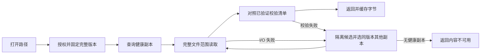

# 12 读取、完整性与缓存一致性

[文档目录](README.md) · [上一章：文件写入与保存语义](11-write-semantics.md) · [下一章：历史内容清除与安全回收](13-retention-and-deletion.md)

<a id="s12"></a>

固定版本、范围读取、分段校验、缓存及断网规则。

## 本章目录

- [12.1 固定版本读取](#s12-01)
- [12.2 HTTP 范围读取](#s12-02)
- [12.3 整文件哈希不能单独验证任意小范围](#s12-03)
- [12.4 缓存键与失效](#s12-04)
- [12.5 读取缓存与脏工作区分别管理](#s12-05)
- [12.6 断网基线](#s12-06)
- [12.7 会话撤销和缓存边界](#s12-07)
- [12.8 操作回执与当前健康观测](#s12-08)

<a id="s12-01"></a>

## 12.1 固定版本读取

打开已提交视图时，将 `(仓库, 分支, 文件身份)` 解析为确定 version_id，后续使用该版本。副本切换只选择同 version_id、大小和内容哈希的健康完整文件，不改用另一历史版本。

所属写入会话可按[第 11.5 节](11-write-semantics.md#s11-05)读取 workspace-view，使用独立授权、接口和缓存身份，不伪造已提交 version_id。SMB 只解析共享主分支，Web 和内部管理接口可明确解析获授权历史或其他分支。



读取失败不能用其他版本的同名文件顶替，也不能用零填补缺失范围。

<a id="s12-02"></a>

## 12.2 HTTP 范围读取

内容接口使用稳定逻辑版本ID，返回完整文件的逻辑字节，支持 `Range`、`206 Partial Content`、`Content-Range`、内容长度和强ETag。每次GET/HEAD/条件请求先核对当前认证、内容墓碑和域状态，再判断304或206；PURGED不得因ETag相同继续返回内容。协议层使用条件请求避免错误复用缓存；具体语义依 HTTP 标准实现。[S18]

```http
GET /api/versions/version-example-002/content HTTP/2
Range: bytes=262144-524287
If-Match: "version-example-002-content-hash"
```

可变的“当前路径”不直接成为永久内容缓存键。先解析当前版本，再读取不可变内容 URL。

随机读取接口应以原文件字节偏移为准，不对响应进行会改变偏移含义的透明内容变换。最后一个范围、空文件、越界和取消必须分别处理，不能用补零掩盖缺失字节。

<a id="s12-03"></a>

## 12.3 整文件哈希不能单独验证任意小范围

保存整文件哈希用于完整性巡检和完整对象验证；另存固定范围的分段哈希，用于随机读取。新版本默认分段大小为 256 KiB，最后一段记录实际长度，并把参数写入版本描述。读取器按描述支持 64 KiB、256 KiB、1 MiB、4 MiB；修改默认值只影响新版本，不能改写历史清单来迁就客户端。256 KiB 是待基准验证的初始折中值，不是已测得的最优值。

客户端或服务端需要验证一个小范围时，先读取并校验其覆盖的完整校验段，再返回所需部分；不得声称仅拿到整文件 BLAKE3 值就能直接验证任意 4 KiB 数据。

`checksums.bin` 本身必须由可信版本描述中的哈希保护。哈希防止意外损坏，不自动防止能够同时篡改数据及校验描述的管理员；后者需要独立签名和更强信任边界，不能靠“有校验和”一词替代。

版本描述与校验清单的获取契约见[第 15.9 节](15-api-and-errors.md#s15-09)。上面的范围示例对应第 08 章长度为 1 MiB 的同名示例版本；跨章节样例必须保持长度、段参数及 ID 对应一致。

分段清单与完整文件共同绑定同一版本。完整文件哈希、分段清单哈希和本盘文件实际长度须一致；任何一项不符均不能计为健康副本。[S22]

以完全落在一个段内、缓存未命中的 4 KiB 请求为例，4 MiB 段需读 1024 倍请求字节，256 KiB 段需读 64 倍；跨段请求分别校验覆盖段。按 32 字节段哈希估算，1 TiB 内容使用 256 KiB 段的哈希数组约 128 MiB，4 MiB 段约 8 MiB，均未计头部。这些是字节量计算，不是延迟或吞吐测量。

服务端完成段校验后可以仅返回请求范围；受控 HTTP 读取使用 TLS 下的服务端验证模式，Web 本身不再读取文件正文。保留的 HTTP 客户端库 如需独立端到端段验证，应申请完整段并明确协商能力。SMB 返回字节前由服务端验证，按标准协议提供文件字节。段缓存记录版本、段号、清单哈希和验证状态；不能把局部缓存标成整段已验证，也不能为减少读取放大跳过校验。

<a id="s12-04"></a>

## 12.4 缓存键与失效

最终字节缓存至少按 `(server_identity, repository_id, history_tree_id, version_id, range)` 区分。工作区缓存另按 `(session_id, workspace_id, file_id, dirty_generation, range)` 隔离。涉及授权的缓存区分用户或安全域，不能只按文件路径与修改时间复用。

目录与属性按分支和提交代际缓存。新提交产生持久事件，客户端失效相关目录项；通知丢失通过游标补读，过旧则重新列举。SMB 桥接须使核心发布与 Samba 租约、缓存失效和变更通知一致，不能只更新 Web 目录。

旧只读句柄可继续读固定版本；新打开按最新已发布目录解析。Web 切分支不串用其他分支缓存；SMB 绑定始终保持主分支。清除、会话撤销和树迁移必须使在线认证与状态缓存失效，不能只因本地已有字节便继续授权。

<a id="s12-05"></a>

## 12.5 读取缓存与脏工作区分别管理

| 数据 | 可否按 LRU 自动清理 | 丢失后的行为 |
| --- | --- | --- |
| 已校验只读缓存 | 可以 | 从服务器重新取回 |
| 目录、属性与缩略图缓存 | 可以 | 重新查询或生成 |
| 未提交脏数据 | 不可以 | 必须恢复、重传或由用户显式放弃 |
| 已提交但响应未知的工作区 | 不可以直接清理 | 先查询原操作状态 |
| 用户明确固定的离线文件 | 按用户策略 | 不能冒充服务器副本，也不能擅自取消固定 |

<a id="s12-06"></a>

## 12.6 断网基线

Web 断网时明确显示请求失败或结果未知，不承诺浏览器缓存可供离线使用。SMB 连接中断时，服务端保留已接收的工作数据；SMB 访问方的本地状态不等于服务器已完成保存。浏览器状态与 SMB 客户端缓存分别管理。缺失范围返回不可用，不返回空内容或其他版本。

第一版不承诺断网后继续产生能够自动写回原分支的提交。已有脏数据保留为待处理状态，恢复连接后重新验证身份、基础文件版本、目录前置条件和写入占用。

重新联网发现冲突时，用户可保留工作区、导出文件，或明确从其基础提交创建新分支；不自动处理内容冲突，也不静默另存为带后缀文件。旧 `MergeLink` 不能替代保存或解决写入冲突；明确采用已有文件节点须按[文件分支合并](design/file-merge-tags-backup.md)检查输入head及结果归属，不自动提交离线脏数据。

<a id="s12-07"></a>

## 12.7 会话撤销和缓存边界

服务端会话撤销后应停止该会话的新读取；共享重绑定后的旧 SMB 会话不能继续请求。客户端按策略删除可清理缓存，但已经被用户导出或被其他应用读到的字节无法远程“收回”。

不能把“撤销服务器会话”描述为可以保证所有离线设备上的已有副本立即消失。

[S18]: https://www.rfc-editor.org/rfc/rfc9110.html
[S22]: https://github.com/BLAKE3-team/BLAKE3


<a id="s12-08"></a>

## 12.8 操作回执与当前健康观测

操作查询保留现有 HTTP 字段与状态。`commit_state` 和 `protection_at_publish` 是冻结的发布事实；之后的副本损坏、永久丢失或历史清除只影响 `current_health`，不能把已发布的成功改写为未提交。

服务端在同一 Engine 临界区内核对当前唯一管理员、操作所属主体和目标状态，再捕获 `OperationReadPlan`。计划只持有所选操作的回执、去重版本描述符、固定路由、共享配置及读租约，不复制完整 State、不在捕获时打开或哈希正文。释放全局锁后，对每个固定副本重新验证磁盘身份、本盘发布证明、校验清单和全部正文哈希；完成后重新核对当前身份和目标状态，再在锁外序列化响应。未授权请求不启动正文健康检查。

读租约在捕获时取得，阻止健康检查期间由引擎清除或迁移所选正文；完成、取消或错误退出均释放租约。健康是本次读取的观测，不是长期保证或可用于提交的保护证据，不使用未经验证的健康缓存。正文总校验量仍与所选提交的不同版本及其副本大小相关，移出全局锁并不等于恒定查询成本。

尚未完成发布的操作只能从可信成员的 ACCEPT/PUBLICATION 日志及其精确摘要绑定的候选找到。当前磁盘格式未在候选头保存 owner/history，因此这一异常路径仍需读取日志、候选和所选 `operation_log` 段目录叶、定位器叶及目标回执段对象（记录内绑定 principal）；不加载整份 State，也不遍历提交、版本、认证分页或正文。所有必要摘要或所属信息不可信时拒绝查询，不把仅 PREPARE 的对象当作已接纳操作。此时保留未决回执和未知健康，不把候选内容的存在视作发布成功。

---

[文档目录](README.md) · [上一章：文件写入与保存语义](11-write-semantics.md) · [下一章：历史内容清除与安全回收](13-retention-and-deletion.md)
