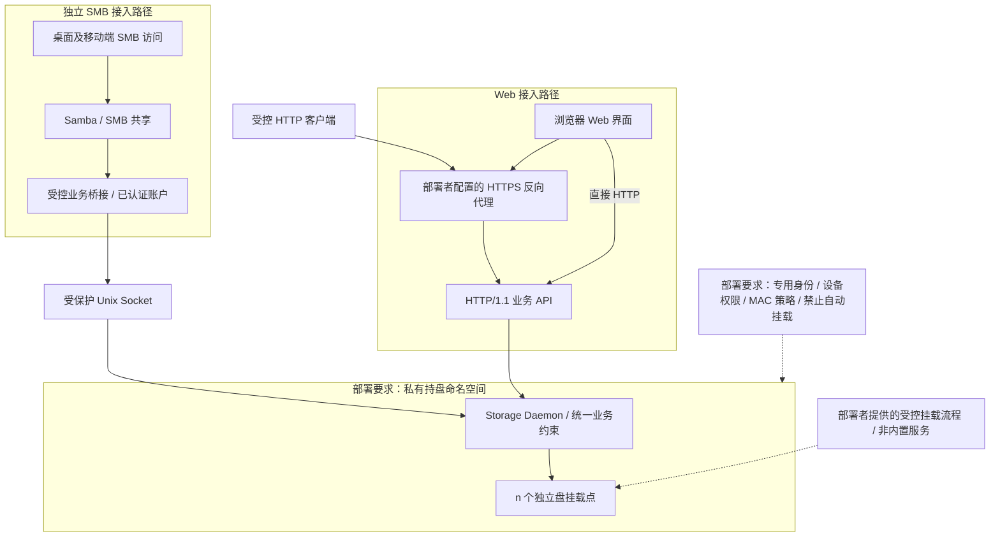

# 14 身份、权限与运行隔离

[文档目录](README.md) · [上一章：历史内容清除与安全回收](13-retention-and-deletion.md) · [下一章：API、操作结果与错误契约](15-api-and-errors.md)

唯一管理员认证、业务操作范围、本机隔离和恢复访问边界。

## 本章目录

- [14.1 部署隔离图](#s14-01)
- [14.2 唯一正常数据入口](#s14-02)
- [14.3 不能只设置一个隐藏目录](#s14-03)
- [14.4 最小特权](#s14-04)
- [14.5 本地身份不能伪造](#s14-05)
- [14.6 唯一管理员与业务对象](#s14-06)
- [14.7 根用户与离线访问的边界](#s14-07)
- [14.8 Web 与网络安全](#s14-08)
- [14.9 故障关闭](#s14-09)
- [14.10 身份与操作范围](#s14-10)

## 14.1 部署隔离图

Web 与 SMB 分别接入服务端，服务端验证唯一管理员身份，统一核心负责业务约束及持盘事务。HTTP 适配器在守护进程内调用业务后端；Unix Socket 用于独立的 SMB 桥接。SMB 桥接仅代理获授权的主分支基础操作，不获得物理目录的直接业务访问权。图中部署要求不表示仓库已提供完整配置或完成目标主机隔离验收。

## 14.2 唯一正常数据入口

普通应用通过 SMB 访问当前主分支，Web 与受控 HTTP API 调用同一核心规则。底层盘目录和版本对象不直接共享，不发布访问内部目录的静态网页路径。

Storage Daemon 的 Disk I/O 是实际持盘组件，恢复、巡检和迁移通过内部受控任务执行。SMB 桥接不能在失败后回退到物理目录直读直写；不得共享可绕过历史和授权的旁路。

## 14.3 不能只设置一个隐藏目录

生产部署需要组合专用服务用户、私有 mount namespace、私有传播、挂载点访问权限、块设备访问控制、systemd 沙箱以及合适的 AppArmor/SELinux 策略。[systemd 审阅样例](operations/deploy/systemd.md)提供部分沙箱配置，不包含挂载辅助进程或 AppArmor/SELinux 策略；设备访问和自动挂载限制仍须由部署者配置并验收。

systemd 的 `PrivateMounts=` 影响挂载命名空间和传播，但不能替代身份、设备权限和路径限制，也不能把原先已公开的设备自动变成安全资源。[S19]

数据盘应由受控挂载流程接管，禁用相关自动挂载。主机普通命名空间不应先把所有盘暴露给用户后，再认为服务端创建一个私有视图就完成隔离。

## 14.4 最小特权

当前仓库不内置挂载辅助服务，也不由守护进程自动挂载或格式化设备。部署者提供的受控挂载流程应只处理白名单设备、登记的 UUID、固定选项及指定命名空间，不接受用户任意路径或任意 mount 参数；如采用独立辅助进程，也必须遵守这些限制。完成挂载后不把长期不必要的特权交给业务服务。

业务进程不向客户端传递底层目录句柄或可写物理文件描述符。本机管理通信可优化传输，但不能绕过命名、历史、授权、一级归属和固定备份目标。

已发布对象使用只读业务权限。文件属主或完整管理员仍可能改变权限，因此它是防意外措施，不是不可突破的防篡改硬件。

## 14.5 本地身份不能伪造

核心收到 Unix Socket 连接时，对端是 Samba 桥接进程，而非最终用户。受保护 socket 和可信进程 UID 只建立代理信任；VFS 还必须检查真实 Samba 安全令牌，拒绝匿名、guest、缺少 Authenticated Users、缺失身份信息和 force-user 会话。只有与显式配置的单一 Samba account_name 精确匹配的已认证会话，才绑定到当前唯一 ZXS 管理员。Samba 与 ZXS 的用户名及密码可以不同，不能把能力字段或客户端自报用户名当作认证证明。

不能允许任意本机程序填写 UID、SID、用户名或 branch_id 就冒充管理员。Web 和受控 HTTP 客户端必须通过当前有效管理员会话；SMB 每次操作重新核对认证身份、共享主分支和绑定代数，不接受多账户映射。本机 `zxs-rescue` 依赖受保护池目录与本机运维身份，执行需要打开池的操作前应停服；它不提供日常管理、账号重置或远程会话入口。

## 14.6 唯一管理员与业务对象

系统只存在一个管理员账户，初始化时可以自选用户名；不存在其他管理员或普通账户，也没有创建、删除、禁用、角色切换、仓库准入列表或 read/write/manage ACL。登录、注销、自助改密、受保护首次初始化、故障管理和明确授权的凭据恢复仍保留。

知道 `version_id`、history_tree_id、内容对象 ID、下载链接或分支名称不等于通过认证。认证成功后仍须检查对象归属、历史域状态、主分支限制、只读别名、内容状态、读取租约、配额和发布证据；PURGED 及迁出源对象不能因物理文件仍存在而重新开放。

`principal` 继续记录审计作者、操作幂等主体和工作区所有者，不承载角色或仓库权限。密码变更撤销全部会话；历史分支、拆分或数据恢复不恢复旧会话。旧多账户凭据格式明确拒绝，不自动挑选账户、迁移或重置；凭据缺失或无效时保持恢复要求。

## 14.7 根用户与离线访问的边界

拥有完整宿主机管理权、能够访问原始块设备或控制启动环境的人，通常仍能绕过应用目录权限。本架构主要防止普通程序和日常操作意外破坏，不声称能抵御完全控制宿主机的攻击者。

盘上若保存明文普通文件，拆盘就能读取本盘内容；这同时意味着物理持盘者可以绕过服务器认证和本机目录隔离。若以后引入加密，应另行定义恢复密钥和独立读取流程，不能既要求无密钥直接读取又宣称失窃盘不可读。

## 14.8 Web 与网络安全

守护进程默认监听 `0.0.0.0:7400` 的 HTTP/1.1，不禁止非回环监听或直连 HTTP 同源访问。网络可达范围、访问隔离与传输保护由部署者保证；HTTP 会明文传输凭据和数据。需要 HTTPS 时，TLS 终止由部署者配置的反向代理承担，不提供忽略证书的默认开关；`--external-origin` 声明浏览器使用的 HTTPS 来源，不会开启内置 TLS。客户端库同样允许 HTTP 或 HTTPS origin，不限制 HTTP 主机为回环；HTTPS 仍验证服务器证书。SMB 必须使用在目标平台完成验收的 SMB 3 安全配置，按部署要求启用签名和加密；远程 SMB 走受控网络通道，不以匿名共享或关闭保护解决兼容问题。认证令牌具有有效期并绑定当前管理员凭据代数；请求执行前重新验证当前会话，敏感操作继续执行对应的确认和业务检查。

浏览器使用会话 Cookie 的变更请求必须通过精确 Origin 与 CSRF 校验；认证请求携带的 Origin 必须与配置的单一外部来源精确匹配（未配置时与请求 Host 对应的 HTTP 来源精确同源，非回环 Host 也可使用），不提供跨源 CORS 放行或多来源白名单。Bearer 请求不要求 CSRF，但携带的 Origin 仍须通过同源校验。存储的 HTML、SVG 等主动内容不得在管理界面的可信同源上下文直接执行。当前 Web 不提供文件正文预览；任何其他受控内容呈现都须隔离或按安全类型提供。

路径使用 ID 和 JSON 名称字段传输，避免多重 URL 解码造成路径逃逸。请求日志不记录令牌、完整敏感文件内容或未经处理的控制字符。

对会产生副作用的请求禁止早期重放执行；幂等键与请求摘要由核心持久化，不能只在网关内存去重。

## 14.9 故障关闭

SMB 服务、业务桥接或核心未就绪时，共享返回不可用；不能退化为普通本地空目录，也不能将物理盘卸载后留下的目录当作正常写入目标。

核心写入前验证设备身份和目录句柄，不仅检查路径存在。客户端挂载共享的本地目录在断开后是否可被写入取决于客户端环境，应在支持说明和自动化任务中要求连接健康检查，不能把客户端本地写入视为已保存到服务器。

服务故障不能通过返回空目录表示全部文件已删除；同步或备份任务必须区分不可用、无权限和真实空目录，防止据此批量删除另一端文件。

## 14.10 身份与操作范围

服务端身份边界负责认证当前唯一管理员；核心不持有用户 ACL，负责对象和存储业务的最终约束。HTTP、SMB 和离线救援不能复制或跳过这些约束。操作幂等重放继续匹配原 `principal` 与请求摘要，工作区继续核对所属主体。

| 操作 | 必须核对的身份和状态 |
| --- | --- |
| 当前文件读取或保存 | 当前认证、目标目录与文件、入口能力、分支状态；SMB 还须核对共享主分支绑定 |
| 历史元数据查看 | 历史树与节点归属、可见状态，不因知道 ID 或名称跳过认证 |
| 历史内容读取或导出 | 当前内容状态、证据及读取租约，不能使用已清除版本 |
| 分支创建 | 同文件来源元数据、目标业务范围及保护规则；纯登记不要求正文可读 |
| 合并连线 | 两端节点归属与关系有效性；不附带文件修改，也不要求已清除内容可读 |
| 文件分支合并 | 参与分支可写且 head 基线未变、结果正文可验证；只读别名不可作为写入目标，详见[合并规则](design/file-merge-tags-backup.md) |
| 当前文件删除 | 当前目录项、冻结基线与占用状态；不等同于清除历史内容 |
| 历史内容清除 | 明确审阅的影响范围、不可变预览及内容保留引用 |
| 历史树拆分 | 当前支持范围、两树独立性、受影响分支和共享绑定 |
| 备份与设备维护 | 策略、拓扑、盘位、成员配置、预期代数及必要的明确确认 |

故障后继续提供正常在线读取，必须能验证已发布状态、当前认证和内容清除记录。认证权威或墓碑状态不能确认时，不得按旧快照放行业务读取；仅允许符合本机信任边界的隔离只读核验与恢复导出。单盘恢复能力不等同于正常在线服务的认证能力。

[S19]: https://www.freedesktop.org/software/systemd/man/latest/systemd.exec.html

---

[文档目录](README.md) · [上一章：历史内容清除与安全回收](13-retention-and-deletion.md) · [下一章：API、操作结果与错误契约](15-api-and-errors.md)
