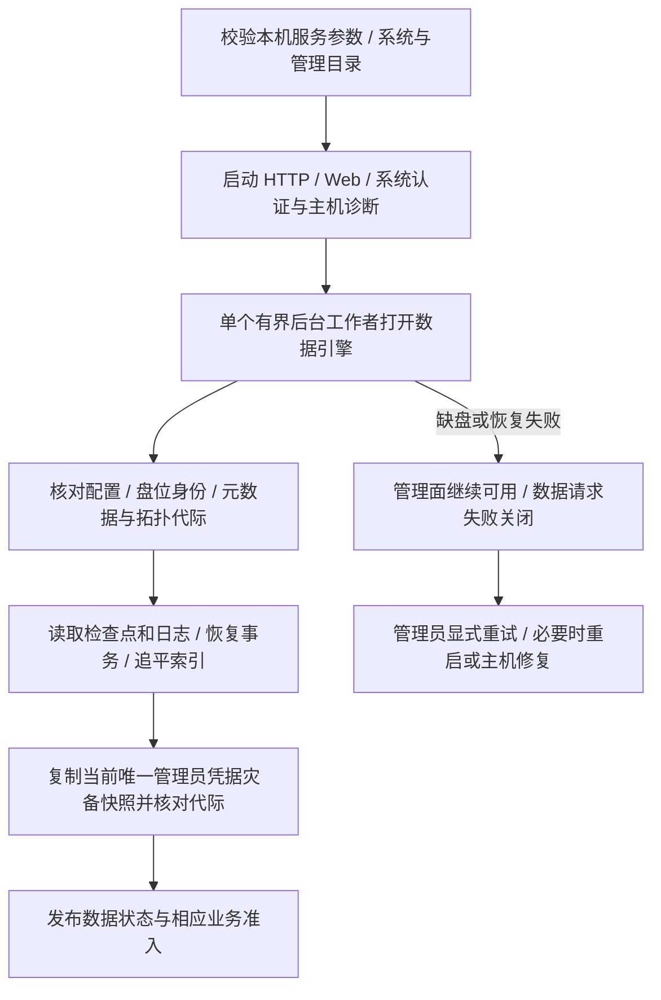

# 17 初始化、启停与硬盘维护

[文档目录](README.md) · [上一章：Web 与内部管理命令行界面](16-client-interfaces.md) · [下一章：故障处理与降级行为](18-failure-handling.md)

设备登记、就绪状态、安全拔盘、换盘和成员恢复。

## 本章目录

- [17.1 初始化与正常启动分开](#s17-01)
- [17.2 启动顺序](#s17-02)
- [17.3 关机顺序](#s17-03)
- [17.4 主动拔盘前检查](#s17-04)
- [17.5 排空与换盘](#s17-05)
- [17.6 元数据成员更换与中断恢复](#s17-06)
- [17.7 运维和审计](#s17-07)

## 17.1 初始化与正常启动分开

首次初始化必须显式执行，确认选择的设备、已有数据情况、身份信息和元数据组。普通启动绝不自动格式化盘、生成新存储池或覆盖已有身份。

本文不提供针对 `/dev/sda` 一类易变设备名的直接格式化命令。部署工具必须先展示稳定设备身份和操作后果。

## 17.2 启动顺序

登录、注销、改密、静态 Web 和主机诊断不以数据就绪为前提；系统目录不可用或监听端口错误仍可能阻止服务启动。Web 静态资源或 HTTP 暂存不可用时，仅相应能力失败关闭，管理 HTTP 与状态接口仍启动；修复本机目录后重启服务。数据状态及请求准入独立控制，不把管理面在线当作数据可读写。管理凭据缺失或损坏不等于空白安装，也不会因数据引擎失败而重置账号。

首次初始化只通过受保护的显式引导执行。中断后的完成入口只覆盖带原始授权、意图及原始空池证明的“存储已初始化、尚未发布认证权威”窗口；已有权威标记或凭据文件即使损坏也不能用此入口覆盖。参见[初始化与恢复](management/setup-recovery.md)。

实际挂载由部署者安排，守护进程不创建、挂载或格式化数据设备。systemd 样例允许启动时缺少数据盘路径；被跳过的路径后来挂载不保证已在服务私有命名空间中可写，应恢复宿主挂载后重启并核实身份与权限。参见[部署限制](operations/deploy/systemd.md)。

## 17.3 关机顺序

先阻止新工作区和新写租约，处理或明确保留已有写入，完成已决定事务或记录恢复状态，持久化必要日志与检查点，再关闭 SMB 接入和管理入口，安全卸载物理盘并停止服务。

守护进程收到停止信号即关闭 HTTP/SMB 新连接准入，并 shutdown 已接入的 SMB socket，唤醒空闲同步接收。SMB 的长期连接使用服务所有者持有并 join 的专用线程，不占 HTTP 共享阻塞池；专用线程及未回收句柄最多 64 个，认证会话仍最多 8 个。正常停止同时等待 HTTP、SMB 已准入操作与管理写线程实际排空；每 30 秒的等待日志不是强杀时限，也不代表工作已经退出。取消服务 future 后，剩余原生线程的 join 义务交给运行时跟踪的阻塞收尾，运行时正常销毁继续等待；若收尾任务创建失败，则同步接回同一份 join 义务，不因任务已入队而重复消费或遗失原生线程。不承诺进程被强杀或调用方强制超时销毁运行时后仍完成排空。

原生恢复线程发生 panic，或退出时发现恢复线程清单／准入状态锁已中毒时，管理准入保持关闭，持有的线程仍须实际 join，再向上返回具体关闭错误；退出清理不解除锁中毒，也不把该情况标记为干净排空。

不能强制先卸载数据盘、再等待核心把待提交文件刷进去。达到关机超时仍有未知事务时，应保留恢复标记，不伪造干净关机。

## 17.4 主动拔盘前检查

对于指定盘，计算它承载的当前及历史完整文件、工作区、清除残留、元数据成员身份和最后健康完整副本，以及分支创建和拆分任务。

“拔盘后仍保持在线访问与目标保护”模式下，先由用户为该盘位指定替换物理盘，或审查新的来源拓扑并完成迁移；不能把副本临时分散到任意空盘。单份版本仅在该一级盘时，须在相同角色的替换盘或用户明确指定的新一级盘完成验证后才能满足该模式。

用户也可以明确选择“保留盘上数据并离线带走”，但系统要展示哪些版本将暂时不可访问、哪些保护等级不足，以及是否导致元数据组全部配置成员条件不满足。

安全卸载只保证停止本系统写入和完成已声明的同步，不等于拔盘后全仓继续完整在线。

## 17.5 排空与换盘

盘状态至少区分 `ONLINE`、`DRAINING`、`OFFLINE`、`SUSPECT`、`QUARANTINED`、`REMOVED`。排空盘不接受新放置，已有读取是否继续由健康策略决定。

换盘计划绑定明确slot_id、copy_level、来源列表及新物理身份，复制和验证全部该角色数据后才更新binding_generation与旧盘状态。该角色兼任元数据成员时，必须同时按[第 17.6 节](17-lifecycle-and-maintenance.md#s17-06)完成成员更换/隔离；不能以业务盘替换绕过控制日志保护。克隆出来的重复 disk_id 必须被识别并停止接纳，不按盘符顺序擅自改认。

## 17.6 元数据成员更换与中断恢复

本节 N 为固定旧配置的成员数，Q = floor(N/2)+1；新配置成员数也必须至少为 1。Q 不随在线数量变化。单成员盘永久丢失时不能执行原池恢复；正常更换必须在唯一旧成员仍可验证时进行。

正常更换和故障恢复都暂停业务写入，采用一次只替换一个成员的保守流程。不能通过修改配置文件跳过记录，也不能因另有健康内容盘就把它视为已有元数据成员。

1. 停止并隔离旧写者，取得独占持盘权限。核实最近有效成员配置及任何未完成的恢复计划，至少取得 Q 个当前旧成员的完整证据。
2. 根据[第 10.7 节](10-transactions-and-recovery.md#s10-07)计算唯一恢复结果，创建 `recovery_id` 和只增不减的新 membership_epoch。计划固定旧新成员集合、可信前缀、各未决槽位结果及候选哈希。
3. 向 Q 个旧成员持久化同一 `RECOVERY_FENCE`，收到 Q 份同步回执后才允许执行计划。该记录禁止旧配置继续接纳业务写入；少于 Q 份时不能激活新配置。
4. 需要补交的旧候选以原 commit_id 和内容身份在 Q 个旧成员形成决定；无候选槽位的中止结果也写 Q 份 `RECOVERY_RESOLVE`。这些是受计划约束的恢复写入，不开放新业务事务。
5. 把已解决前缀、决定证明、策略、操作结果及成员计划完整复制到新组全部成员；内容另行校验，缺失内容记录明确健康状态。
6. 生成包含旧组 Q 份 FENCE/RESOLVE 回执的新配置激活记录，向新组全部成员写入 `CONFIG_ACTIVATE` 并同步。再生成引用新组全部成员的激活回执的激活完成证明并写入新组全部成员；完成前不开放正常写入。
7. 在新组全部成员持久化新的 writer_epoch。对需恢复完成的候选，由新组全部成员分别同步依赖并记录 REPROTECT，生成当前代际 FINALIZE，再按[第 10.10 节](10-transactions-and-recovery.md#s10-10)恢复 PUBLICATION、两类本盘证明、操作结果和索引。已有有效发布记录保持原保护事实；缺少正常发布证据且不能补齐内容时，按唯一恢复计划记录降级结果。普通新提交仍须全部配置成员和逐版本保护达标。
8. 旧盘重新插回只能核查或隔离。成员身份和代际来自可信配置链，不按盘符、mtime 或“最高自报 epoch”决定接纳。

恢复计划本身只有 Q 份旧成员 FENCE 持久化后才能获得执行资格。若中断后仅见少于 Q 份计划，而一个可信 Q 成员观察集合的完整记录均无计划，允许在隔离旧写者后废弃这个未获资格的计划。若所取 Q 个旧成员中任一个记录了计划，则保守地继续该相同计划并补齐证据，不创建不同目标组。发现两个不同有效计划立即停止调查。

新配置激活中断时，只能重试同一 recovery_id、成员集合和代际，不能从旧配置重新开展业务写入。存在有效激活完成证明时按新配置恢复；只有部分激活记录时继续同一计划，要求能重建旧组 Q 份授权证据和新组全部成员完整状态。所需成员暂时不可用时保持停止，不隐式退回旧组。

少于 Q 个可信旧成员且没有足以验证已完成配置切换的证明时，不承诺恢复原池写服务。允许从剩余盘只读核对和导出，再由管理员显式建立不同 pool_id 的新池并导入；必须展示无法确认的事务及缺失版本，不能称为原池无损接管。配置锚缺失的旧盘不兼容，不在读取时自动生成或迁移；每个新初始化盘均须持久保存池配置锚。

## 17.7 运维和审计

维护任务包括磁盘健康、Btrfs与逻辑巡检、来源和级别完整副本验证、指定盘位修复、清除残留、拆分恢复、用户确认的拓扑迁移、容量建议、检查点及GC。后台任务不能自行做跨来源负载均衡。

每项任务要有 ID、作用范围、进度、可取消阶段和最终结果。后台任务可以限速或暂停，但不能因暂停而让已持久化的提交回退成未提交。

以上为维护要求，不表示完整后台巡检已实现。当前 `Engine::check` 是逐盘版本、本盘证明、墓碑和正文诊断，服务端仍在引擎锁内执行；不是覆盖全部快照/历史元数据依赖的有界周期巡检。[增量发布门禁](adr/0005-incremental-publication-integrity.md)要求先落实真实扫描、资源上限、状态和调度，并覆盖失败、取消、过期及与发布/清除/恢复交错，再移除普通写入的旧依赖检查。完整成功必须标明检查基线、覆盖与时间，未就绪/部分失败不得显示健康，普通发布也不刷新巡检成功时间。

需要可观测的指标包括每级盘位/来源占用、备份链完整度和拓扑迁移进度、每盘可用空间、SMB 会话和失败保存、分支首次写入和拆分过渡占用、合并连线记录状态、PURGED节点与离线清除残留、版本保护不足数、不可读版本数、日志成员健康、事务状态分布、未提交工作区空间、校验错误、缓存命中和读写延迟。告警不能只看 CPU 或内存正常就判定存储正常。

---

[文档目录](README.md) · [上一章：Web 与内部管理命令行界面](16-client-interfaces.md) · [下一章：故障处理与降级行为](18-failure-handling.md)
