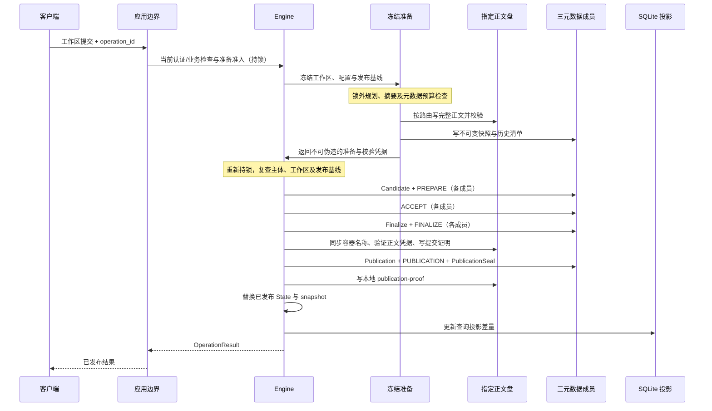

# 一次写入的完整流程

[架构专题](README.md) · [事务规范](../10-transactions-and-recovery.md) · [写入语义](../11-write-semantics.md)

本页描述普通工作区内容提交的当前代码路径。纯元数据操作没有正文复制；恢复使用独立证据检查路径，不等同于重新执行下面的正常提交。正常新写入要求三元数据成员可用，不自动降级。

## 1. 规划不是发布

[plan_mutation_digest](../../src/engine/src/engine.rs) 将操作 ID 与请求摘要及主体绑定：相同请求可以查回原结果，复用 ID 提交不同输入会失败。新操作检查写入条件，复制状态，应用变更并登记拟发布结果与事件。规划中的 `PUBLISHED` / `TARGET_MET` 字段是候选结果，不是已落盘成功证明；只有完成发布闭包后才返回成功。

[工作区准备](../../src/engine/src/engine/workspace_commit.rs) 在锁内捕获基线，锁外执行重活，发布前再次校验工作区所有者、业务状态、内容、代际与租约。详见[分离准备](detached-workspace-commits.md)。

## 2. 准备正文与元数据

[prepare_publication](../../src/engine/src/engine/publication.rs) 检查指定路由容量、元数据预留、候选对象大小与哈希。正文按每个文件的版本顺序及保护路由复制，独立文件使用有界并行。已存在正文也必须校验。准备将完整正文及不可变元数据写到目标盘，但不写任何决定日志。

准备持有与候选、磁盘和实际文件绑定的校验证据。大批量达到句柄上限时采用完整重读回退，不能假定决定阶段始终没有正文 I/O。取消或过期准备可能留下未引用不可变对象，不会自动发布。

## 3. 串行决定与成功边界

[decide_publication](../../src/engine/src/engine/publication.rs) 先复查根目录、快照、序号、决定槽、配置、正文凭据与空间。失配返回可重试的 `PREPARATION_STALE`；尚未写 ACCEPT。各成员写入 Candidate 与 PREPARE 后，进入可能产生不可撤销决定的区域。

[complete_candidate_verified](../../src/engine/src/engine/publication.rs) 收集 ACCEPT、写 FINALIZE，再同步名称和正文提交证明，形成包含结果及各类收据的 Publication。全部配置成员 PUBLICATION、PublicationSeal 和正文盘本地发布证明都完成后，才替换内存状态并更新 [SQLite 投影](../../src/engine/src/engine/index.rs)。SQLite 仍是可重建投影，权威证据在日志及不可变对象中。

## 4. 失败后怎么判断

- PREPARE 之前的校验失败：没有新决定；保留原工作区，按错误修正或以原操作 ID 重试。
- ACCEPT 可能到盘之后：发布步骤失败返回 `IN_DOUBT` 并阻止继续写入；查询原操作并执行恢复，不能另造 ID 当作确定失败重交。
- 权威发布完成后 SQLite 投影更新失败：返回原发布收据，停用索引并保留具体阶段、序号和错误来源；后续历史查询从 State 扫描。它不撤销独立完成的成员元数据 epoch 或阻断下一次权威发布。
- 工作区终态镜像落盘属于另一发布后步骤：失败仍保留来源与写入阻断；其错误分类窗口未由索引修复消除，须按原操作查询，不能广义 catch 为成功。
- 恢复没有进程内的正文校验证据，需要重新读取验证；历史成功与当前正文健康分别判断。

这张图是源码路径说明。真实掉电、拔盘与设备缓存行为的验证状态见[交付边界](../23-delivery-and-decisions.md#s23-03)，不能从时序图或临时目录测试推断设备验收已完成。
