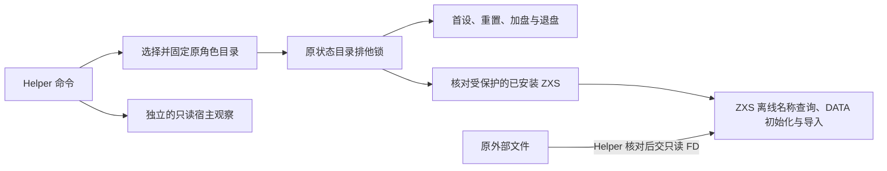

# Helper 架构

供维护者阅读。Helper 是 Linux x86_64 上按需运行的命令行工具，不是存储服务。
用户入口见[使用说明](README.md)；证据和待验收范围见[状态表](TASKS.md)。

## 数据流

检查与服务单元预览只检查原目录的资格，不走写入分支。

- **首设与本地维护：**首设先写角色标记，最后发布 `server.conf`。重置仅更新原账号代次、密码盐和验证值，不换登录名、池或角色。
- **固定离线交接：**只使用由 root 保护的 `/zxs/bin/zxs`。查询、初始化和导入使用各自的私有入口，不走业务 HTTP 监听。
- **导入：**Helper 绑定原文件、摘要、目标名和已登记 DATA；ZXS 发布首节点并给出原回执。批量只启动一个配套写入进程，先查回执，所需时才交源文件。
- **输出与恢复：**每项回执输出前后重验原件，确认后才开始下一项；整批还需确切结束和正常退出。批量不是事务，只重放原计划，不删除来源。

[首设、重置与盘管理](docs/guides/headless-offline.md)和[导入指南](docs/guides/offline-imports.md)说明操作前提。
首设之后的监听与部署见 [ZXS 部署说明](../zxs/docs/headless-activation.md)。

## 核心不变量

- 首设与维护使用原专用非 root 账号。角色身份绑定持有的目录、实际挂载和标记，不能通过同名路径、同设备号或任意目录替换。
- 修改配置之前持有原状态目录排他锁；后续每次跨边界核对原清单和角色。详见[原件与离线权限](docs/invariants/offline-authority.md)。
- 退空 DATA 只更新 SYSTEM 和清单。仍有原路由时必须核对[选中回收回执](docs/specs/recycle-retirement-receipts.md)，不以其代替正文校验。

## 源码导航

| 位置 | 负责的边界 |
| --- | --- |
| [主入口](src/main.rs)、[终端动作](src/headless_setup_command.rs) | 子命令、前台确认、不回显的凭据与互斥动作 |
| [首设与角色](src/headless_setup.rs)、[路径原件](src/pinned.rs) | 初始登记、按原角色核对路径和挂载 |
| [离线会话](src/headless_setup/offline.rs)、[盘操作](src/headless_setup/offline/) | 原清单、排他锁、受控发布及中断证据 |
| [原票和来源](src/headless_setup/offline/import_one.rs)、[批量交接](src/headless_setup/offline/import_one/batch/worker.rs) | 持有原件，批量原回执优先及逐项确认 |
| [本地工作进程](src/local_worker/)、[Linux 证据库](linux-evidence/) | 固定可执行文件、来源描述符和真实进程退出 |
| [宿主观察](src/block_tools.rs)、[可选发布器](src/embedded_image/) | 两条旁路，不提供池或账号写入权 |

## 独立能力

[宿主观察](docs/guides/host-diagnostics.md)不代替池登记和数据核验。
[可选 ELF 发布](docs/guides/embedded-image.md)需要独立启用，默认不内嵌 ZXS，不启动服务。
旧 SQLite/SMB 和[镜像工具、网页](docs/archive/retired-volume-tools.md)不在当前交付中。
