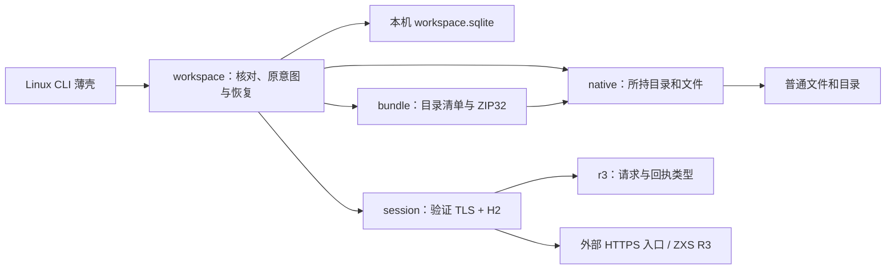

# zxs-core 架构

供维护客户端核心与薄壳的人阅读。只画当前 Linux 普通文件路径；安装、平台和真实服务资格见[任务清单](TASKS.md)。

## 所有权与数据流

| 层 | 只负责什么 |
| --- | --- |
| CLI | 接受明确选择和确认。带地址的入口须认证；本地核对、打包和离线打开不建会话。 |
| 原生适配 | 不挂接虚拟盘。先在持有的目录中鉴定普通文件，再打开原 inode；匿名暂存校验后不覆盖发布。 |
| 工作区 | 私用 SQLite 绑定普通编辑路径、原服务器基线、待决意图与原回执。只留待决正文，不建立本机版本历史。 |
| 会话与协议 | 证书和 ALPN 均通过才构造敏感认证头。在已选 H2 信道使用现有 R3，回执与服务端冻结字段逐项匹配。 |
| 代码包 | 按[确定性 ZIP32 规格](docs/specs/zip32-bundle.md)打包。目录清单只存本机，当前无远端 ZIP 端点。 |

原内容先由用户正常编辑，再显式冻结。重开与重查分别见[本机回执边界](docs/invariants/receipt-recovery.md)。服务端版本仍归 ZXS；客户端不读、写或接管旧 Workspace 的 STATE、STORE 或归档历史。

[仅静态] [共享签出选择](src/workspace/checkout.rs)在确认前核定原分支头和版本，持有普通输出目录。同一会话复核后只读原节点；完整验校暂存，再读原版本，最后不覆盖发布并登记本机基线。最后一次读取不是远端保留；已变更时重新选择。现有 CLI 不变。

## 源码导航

| 路径 | 职责 |
| --- | --- |
| [src/bin/zxs-client.rs](src/bin/zxs-client.rs) | Linux 命令行、确认与只读恢复入口。 |
| [src/workspace.rs](src/workspace.rs) | 本机基线、去向、原号和冷恢复；只在明确确认后尝试写入。 |
| [src/native.rs](src/native.rs) | Linux 文件/目录描述符、私有租约与原子不覆盖发布。 |
| [src/session.rs](src/session.rs) · [src/r3.rs](src/r3.rs) | 同一验证过的 HTTPS/2 信道、完整正文流及准确 R3 语义。 |
| [src/bundle.rs](src/bundle.rs) | 本机扫描、忽略规则、清单比较和标准 ZIP32 写入。 |
| [tests/linux_zip.rs](tests/linux_zip.rs) · [src/native_tests.rs](src/native_tests.rs) · [src/workspace_tests.rs](src/workspace_tests.rs) | 离线 CLI、独立 ZIP 读取和真实 ext4 文件、原操作保护边界。 |

目录独立构建，不引用同仓服务器、Helper 或旧客户端。Bearer、Range、续传和上层 GUI 不计入这张图。
