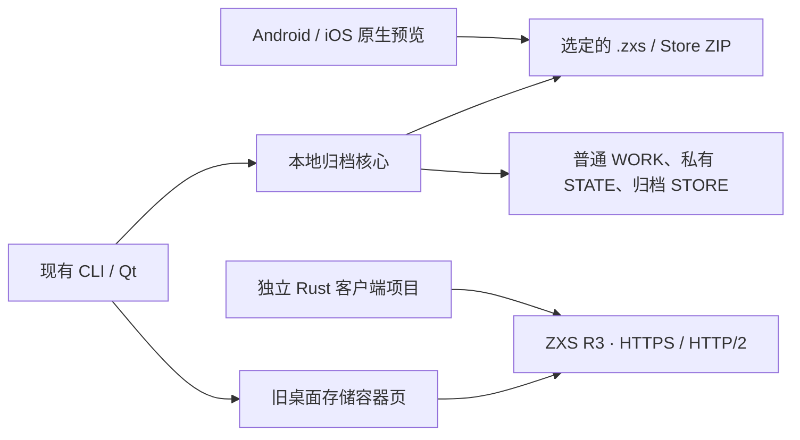

# ZIP Workspace 架构

给维护 CLI、桌面和原生预览的开发者。先分清本机归档与远程单文件，再按下表找到实际源码。功能的验证范围见[交付状态](TASKS.md)。

## 两条产品路径

| 路径 | 持久事实 | 不会发生 |
| --- | --- | --- |
| 本地 `.zxs` | 普通目录的完整、未压缩 ZIP 快照；STORE 的已验证分支槽和父链说明历史。 | 普通保存不提交；不需要 ZXS 服务；普通 ZIP 不自动成为仓库。 |
| 现有远程容器 | ZXS 保存一次显式提交的单文件完整正文；客户端留存原操作，核对精确回执。 | 查看列表、打开容器、编辑本机文件、关窗都不提交。 |
| 新版客户端 | 独立 [`zxs-core`](../zxs-core/README.md) 从普通本机目录走明确提交。 | 不接管本项目 STATE、STORE 或旧版本，也不是本项目的构建依赖。 |

本机归档、持续持有卷的读写与发行是三种独立资格。现有桌面的工作树写入只使用本窗口实际建立并持有的会话，不能按显示路径接管既有 STATE。CLI 可按已登记原号恢复，两者不同。

## 三个本地位置

| 位置 | 作用 |
| --- | --- |
| WORK | 普通编辑目录，保留同一工作树身份；可有多个独立实例。 |
| STATE | 本机私有的基线、原操作记录、原包与冻结候选；不放进 ZIP。 |
| STORE | 保存正式 ZIP 快照和分支槽；不是数据库、锁服务或远程容器凭据。 |

三个位置不得互相包含。相同拼写或字节不能代替原实物。接入已挂载的共享作为普通文件来源，不等于通过实际 SMB 的写入、断线或重开资格。见[本机位置、空间和恢复](docs/invariants/local-worktree.md)。

## 4. 提交、竞争与断线

1. 显式签出或登记选定的原树；提交前停写，冻结并核对整树。私有原意图和候选耐久后才可发布。
2. 只写原选 STORE 的新槽，不覆盖；读回与同步完成再确认。已出现的新内容不自动充当分支头。
3. 同代竞争、丢答或原目录变动时，只按原号查询或续作。保留原材料，不从后来编辑重建候选。

归档标记、整树摘要、完整 ZIP 的字节摘要和原本机实体是不同证据。[归档规格](docs/specs/archive-format.md)定义格式；[本机恢复](docs/invariants/local-worktree.md#中断先查原号)给出原命令。

## 源码导航

| 入口或模块 | 文件与作用 |
| --- | --- |
| CLI、Qt | [`cli.py`](zipworkspace/cli.py) 与 [`desktop/`](zipworkspace/desktop/)；接收选择和明确确认，不把界面当成协议。 |
| 归档准入、索引、历史 | [`model.py`](zipworkspace/model.py)、[`archive.py`](zipworkspace/archive.py)、[`browser.py`](zipworkspace/browser.py)、[`refs.py`](zipworkspace/refs.py)。 |
| 工作树、冻结和发布 | [`worktree.py`](zipworkspace/worktree.py)、[`opening.py`](zipworkspace/opening.py)、[`freeze.py`](zipworkspace/freeze.py)、[`publish.py`](zipworkspace/publish.py)、[`lifecycle.py`](zipworkspace/lifecycle.py)。 |
| 旧的远程收发 | [Qt 容器页](zipworkspace/desktop/container_panel.py)、[TLS/H2](zipworkspace/container_https.py)、[原计划](zipworkspace/container_plan.py)、[原回执](zipworkspace/container_http.py)。操作见[远程容器页](docs/container-management.md)。 |
| 原生平台适配 | [Linux 只读卷](zipworkspace/linux_mount.py)、[Linux 编辑卷](zipworkspace/linux_edit_mount.py)、[WinFsp](winfsp/) 和 [FSKit](macos-fskit/)，各自受[发行门槛](TASKS.md)限制。 |
| 移动预览与草稿 | [Android](android/) 和 [iOS](ios/) 的原生代码。中央目录声明、单项 CRC 和整份 `.zxs` 核验不是同一证据；预览不授予写入。 |

开发和构建仅使用本项目的 [`pyproject.toml`](pyproject.toml) 及其声明依赖。应用各自产生制品，不根据是否存在相邻项目改变运行行为。

[改写前的详细实现、历史设计及约束](https://github.com/isarmg/zxs/blob/85a8988c386baad1305f4f81ce2c57786df6e436/zxs-workspace/ARCHITECTURE.md)仍可查阅，不替代当前发行状态。
