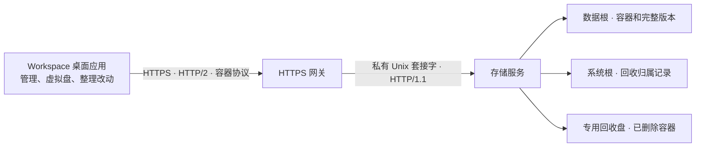

# 文件容器存储架构

## 业务边界

Workspace 管理本地目录和编辑流程，把临时文件替换、路径调整等行为整理为单个容器的明确操作。普通编辑器的保存只写本机；点击 Workspace 的提交才上传。各个容器独立提交，同一容器的相依操作按顺序执行。

| 操作 | 服务端行为 |
| --- | --- |
| 保存新文件 | 接收一份完整正文，建立容器和 `main` 的首节点。 |
| 保存到已有分支头 | 检查基节点，在该分支追加一个完整节点。 |
| 从历史 `main` 节点保存 | 以选中的历史节点为父，一次创建新分支和首节点；`main` 保持原样。 |
| 建立分支 | 从已存在的节点建立分支，不复制正文。 |
| 改名或换标签 | 只更新原容器的元数据，不新建节点。 |
| 删除 | 把整个容器移入专用回收盘，保留分支、节点和标签。 |
| 读取 | 列出容器、标签和分支节点，读取指定节点的完整正文，或查询指定操作的回执。 |

## 保存和回执

每次保存只上传一个文件的完整正文。服务器边收边写暂存文件，核对长度和摘要，先同步正文，再发布节点和回执。中断的正文不发布；进程意外退出后，服务重启时清理识别出的未发布暂存，不触碰已发布节点。没有服务器工作稿、区间写入或增量链。

每项变更有自己的操作号。客户端收到准确回执后确认结果；断线或没有收到答复时，用原容器和原操作号查询。每个容器分别报告结果，另一个容器提交失败不撤销已经成功的项。

删除跨文件系统时，先写完并同步回收盘上的目标，再记录归属切换，最后清理原位置。已切换而原位置尚未清理是可查询的状态；不把原位置再次作为活动容器。

## 部署和传输

存储服务保持系统根、数据根和专用回收根的身份。专用回收盘与系统、数据使用不同的文件系统；数据正文使用普通文件。Helper 负责初始化和离线管理，不常驻存储进程。桌面应用经 HTTPS HTTP/2 访问网关，不回退到 HTTP/1.1。只有网关到存储服务的私有 Unix 套接字使用 HTTP/1.1。管理界面仅在桌面应用内。
