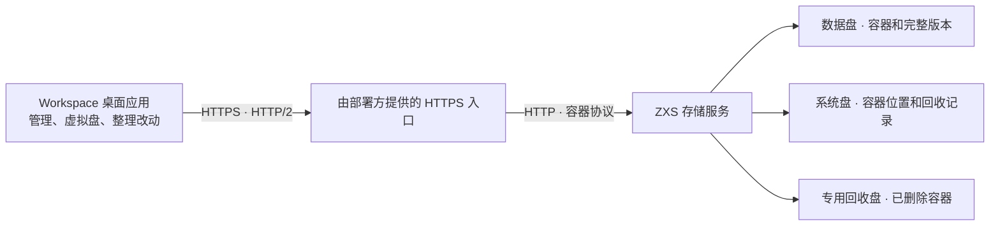

# 文件容器存储架构

## 业务边界

Workspace 管理本地目录和编辑流程，把临时文件替换、路径调整等行为整理为单个容器的明确操作。普通编辑器的保存只写本机；点击 Workspace 的提交才上传。各个容器独立提交，同一容器的相依操作按顺序执行。

| 操作 | 服务端行为 |
| --- | --- |
| 保存新文件 | 接收一份完整正文，建立容器和 `main` 的首节点。 |
| 保存到已有分支头 | 检查基节点，在该分支追加一个完整节点。 |
| 从历史 `main` 节点保存 | 以选中的历史节点为父，一次创建新分支和首节点；`main` 保持原样。 |
| 建立分支 | 从已存在的节点建立分支，不复制正文。 |
| 改名或换标签 | 只更新原容器的元数据，不新建节点。 |
| 删除 | 把整个容器移入专用回收盘，保留分支、节点和标签。 |
| 读取 | 列出容器、标签和分支节点，读取指定节点的完整正文，或查询指定操作的回执。 |

## 保存和回执

每次保存只上传一个文件的完整正文。服务器边收边写暂存文件，核对长度和摘要，先同步正文，再发布节点和回执。中断的正文不发布；进程意外退出后，服务重启时清理识别出的未发布暂存，不触碰已发布节点。没有服务器工作稿、区间写入或增量链。

新容器通过校验后，先在系统盘记录选中的数据盘，再发布首节点。后续操作和重试使用这条记录，不因盘离线就另选一块。删除后保留原盘记录，用于清理原位置。

上传正文不持有容器锁，完整正文校验后才加锁选择版本。首次保存、向已有头追加、从历史 main 分叉是三种不同的目标：只有首次保存带初始名称，已有分支必有一个头。普通变更先在锁内区分精确重试和新请求；只有完成持久发布的新请求才更新内存。冷启动从磁盘读取的回执仍逐项验证。

每项变更有自己的操作号。客户端收到准确回执后确认结果；断线或没有收到答复时，用原容器和原操作号查询。查询在同一个容器锁内先判断是否已回收，只访问当前选中的账本；回收盘数据缺失或回执相互矛盾时报告不可用，而不是未找到。每个容器分别报告结果，另一个容器提交失败不撤销已经成功的项。

删除跨文件系统时，先写完并同步回收盘上的目标，再记录归属切换，最后清理原位置。已切换而原位置尚未清理是可查询的状态；不把原位置再次作为活动容器。

回收以已登记的原盘身份和完整原件证据绑定，冷重挂不依赖临时设备号。见[回收记录规格](docs/specs/recycle-record.md)。

## 离线空 DATA 初始化

Helper 显式选择现有清单中的一块 DATA，存储程序在同一原始停机租约下验证角色标记及清单绑定，只为目标建立现行空布局。它不调用常规启动路径，不清理暂存，也不为其他 DATA 获取业务所有者锁；目标原有正文、临时上传或系统登记都是拒绝继续的依据。

## 部署和传输

启动或离线打开时，状态目录与各角色目录必须互不包含；即使路径拼写不同，若一个已选目录出现在另一路径可见的祖先链中也会拒绝。此检查不推断挂载边界外不可见的祖先。首次部署登记一个系统根、一块专用回收盘和一块或多块数据盘；数据正文使用普通文件。启动时要求登记的盘都已挂载。运行时若数据盘离线，该盘容器会报告不可用；其他盘仍可按容器读写。若列表、新建或改名需要读取离线盘上的容器，本次请求返回不可用，恢复磁盘后再重试。如果重新挂载了磁盘，重启服务重新核对。Helper 负责初始化和离线管理，不常驻存储进程。服务只监听部署方指定的 HTTP 地址，不处理 TLS，也不依赖或识别代理。桌面应用与部署方的 HTTPS 入口只使用 HTTP/2。管理界面仅在桌面应用内。
