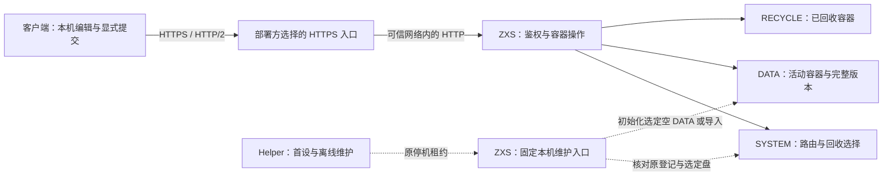

# ZXS 存储架构

ZXS 保存单个文件的完整历史版本。客户端负责在普通目录编辑和发起提交；服务只保存明确提交的原始字节，不解析 ZIP。运行证据见[交付与验收](TASKS.md)。

## 保存、读取与回收

| 操作 | 数据流 |
| --- | --- |
| 首次保存 | 收完整正文，核对长度和 SHA-256，先同步正文，再选定 DATA 路由并发布 `main` 首节点和回执。未路由时按[首次选盘规则](docs/specs/data-placement.md)选择暂存盘。 |
| 保存或分叉 | 从当前分支头追加完整节点，或从选定的历史 `main` 节点一次发布新分支及其首节点。建分支、改名和标签只更新元数据，不复制正文。 |
| 拿到原回执 | 用原容器号和原操作号查询。只读当前选中的账本；数据缺失、磁盘离线或证据矛盾时报告不可用，不能当作未找到。 |
| 回收 | 先同步 RECYCLE 的完整副本，再持久化 SYSTEM 的选择记录，最后清理 DATA 原件。清理待完成不撤销已选结果；见[磁盘格式](docs/specs/recycle-record.md)。 |

## 必须保持的边界

- **内容与发布。** 正文接收不占用容器写锁；完整校验后才加锁选择版本。不同容器各自提交；其中一项失败不撤销别项。重启只清理能识别的未发布暂存，不触碰已发布版本。
- **原盘与挂载。** 路由建成后不因满盘或离线改盘。启动要求登记盘在位；运行时未受影响的容器仍可读写。若全局列表、新建或改名必须访问离线盘，则整次请求不可用。原盘重挂后重启核对。
- **可信角色与停机。** 状态目录与各角色不重叠，检查可见祖先，不推断挂载外关系。Helper 不常驻；空 DATA 初始化只建立指定盘的 `owner`、`data`、`staging`，拒绝已有正文、暂存或路由。
- **传输。** ZXS 只监听显式指定的 HTTP 地址，独立校验账户，不终止 TLS 或信任代理身份头。外部 HTTPS 转接由部署方选择。现行 R3 沿用整文件传输。[会话与后端复用](docs/specs/sessions.md)单独验收；Range、按偏移续传为 [设计中]。

## 找源码

| 主题 | 入口 |
| --- | --- |
| 启动、配置与挂载 | [`main.rs`](src/main.rs)、[`headless_start.rs`](src/headless_start.rs)、[`fs/`](src/fs/) |
| 鉴权、HTTP 与 R3 | [`headless_auth.rs`](src/headless_auth.rs)、[`headless_http.rs`](src/headless_http.rs)、[`workspace_protocol/`](src/workspace_protocol/) |
| 版本、路由和原回执 | [`container_store.rs`](src/container_store.rs)、[`model.rs`](src/container_store/model.rs)、[`routes.rs`](src/container_store/routes.rs)、[`operation.rs`](src/container_store/operation.rs) |
| 回收、磁盘记录和原件 | [`recycle.rs`](src/container_store/recycle.rs)、[`recycle_receipt.rs`](src/container_store/recycle_receipt.rs)、[`recycle_material.rs`](src/container_store/recycle_material.rs) |
| 原停机租约、只读和导入 | [`headless_offline.rs`](src/headless_offline.rs)、[`headless_import_worker.rs`](src/headless_import_worker.rs)、[`init_data.rs`](src/container_store/init_data.rs) |
| 证据与源码夹具 | [单元夹具](tests/unit/) · [隔离客机产品冒烟](tests/acceptance/guest_product_smoke.py) |

实际部署从[使用说明](README.md)开始。
