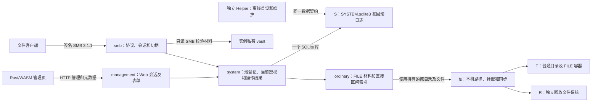
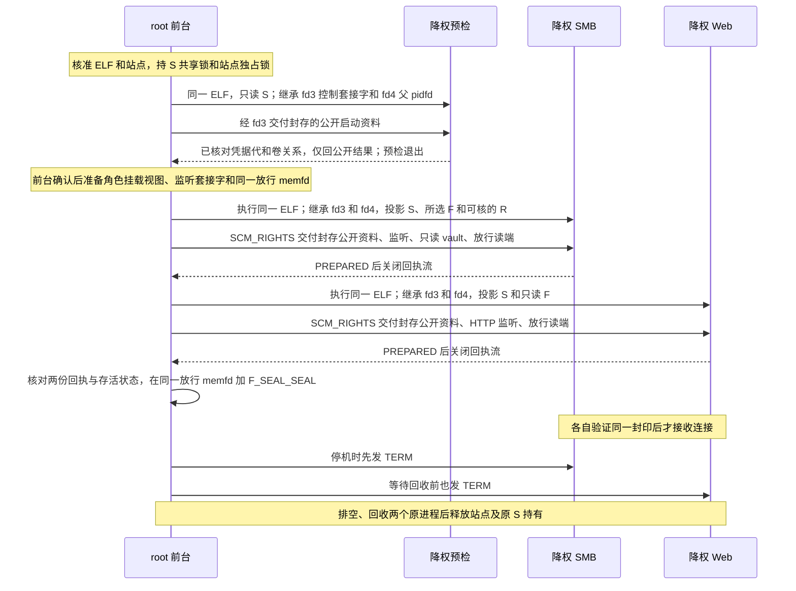
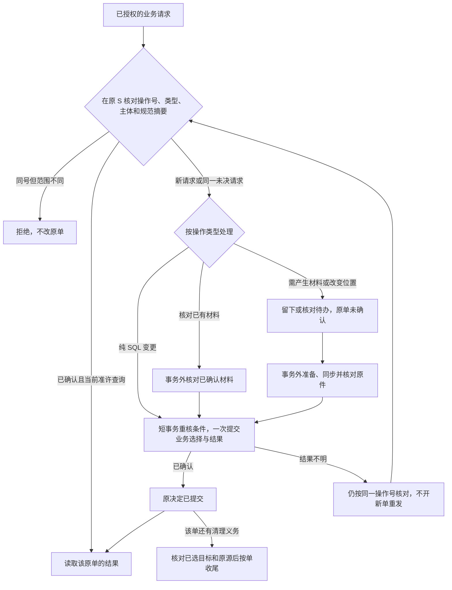

# ZXS 架构图

[顶层设计](../ARCHITECTURE.md) · [当前范围与验证](status.md) · [术语](glossary.md)

## 1. 模块与数据

Web 通过 `system` 读取获准的名称、共享和历史；手动提交时核对普通盘材料，不把正文送到浏览器。宿主负责挂载 S、F、R。Helper 停机写入采用同一格式，不是 ZXS 的运行依赖。

源码：[Web](../src/management.rs) · [浏览器](../src/browser/) · [SMB](../src/smb/mod.rs) · [SQLite 入口](../src/system/reader.rs) · [FILE 工作稿](../src/ordinary/flat/) · [实际文件系统](../src/fs.rs)

## 2. root 前台怎样放行 Web 和 SMB

`fd4` 指向原前台进程，不是文件数据。投影是子进程看见的挂载树，不经启动消息转交数据盘 FD。预检的 S 强制只读；Web 的 F 强制只读，S 保留原挂载模式，允许在可写 S 上提交获准的 SQL 变更。Web 没有 R、vault 或 SMB 监听。前台不打开 SQLite；两个业务进程各自重新核对原 S、安装描述和共同凭据代。监听提前建立不等于已经开始处理请求。

源码：[入口与排空](../src/smb/launch/application.rs) · [挂载视图](../src/smb/launch/custody/view.rs) · [执行同一 ELF](../src/smb/launch/custody/birth/child.rs) · [交付与确认](../src/smb/launch/custody/start.rs) · [共同放行](../src/smb/launch/pair_gate.rs)

## 3. 同一操作号怎样完成

| 实际入口 | 这类操作怎样绑定与确认 |
| --- | --- |
| Web 改共享模式，`kind=4` | 按 Web 主体、当前凭据代、`ShareId` 和前一设置核对真实变更；新模式和结果同一事务提交，不准备 FILE。 |
| SMB 保存，`kind=6` 或 `10` | 按实际 SMB 写权限、原 FILE、前一工作修订及本轮材料确认首稿或更新稿。操作号在服务端绑定；保存不发正式节点。 |
| Web 显式提交，`kind=11` | 表单固定原 FILE 和已确认工作修订。核对材料后在原 S 选择正式节点。回执查询限仍有效的原会话和原表单；查询不提交或重试。 |
| 名称或位置变化，`kind=12`、`14`、`16` | 各自冻结原父、名称、角色、位置和权限；同盘改名不是复制，回收或跨盘交接另核目标和材料。已选新位置与清源完成分别记录；普通 F 跨文件系统执行仍未放行。 |
| Helper 首设与重置 | INIT 与账户操作各有原单；需跨 SQL、卷标或私有校验材料时按各自原单完成。数据库的提交不覆盖另一个文件系统。 |

源码：[操作表](../src/system/schema.sql) · [共享模式](../src/system/share_mode.rs) · [工作修订](../src/system/work_change.rs) · [手动节点及回执](../src/system/manual_work.rs) · [FILE 交接](../src/system/file_transfer.rs) · [首设与重置契约](first-account-v1.md)
